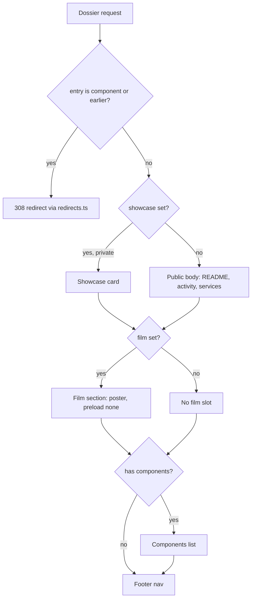
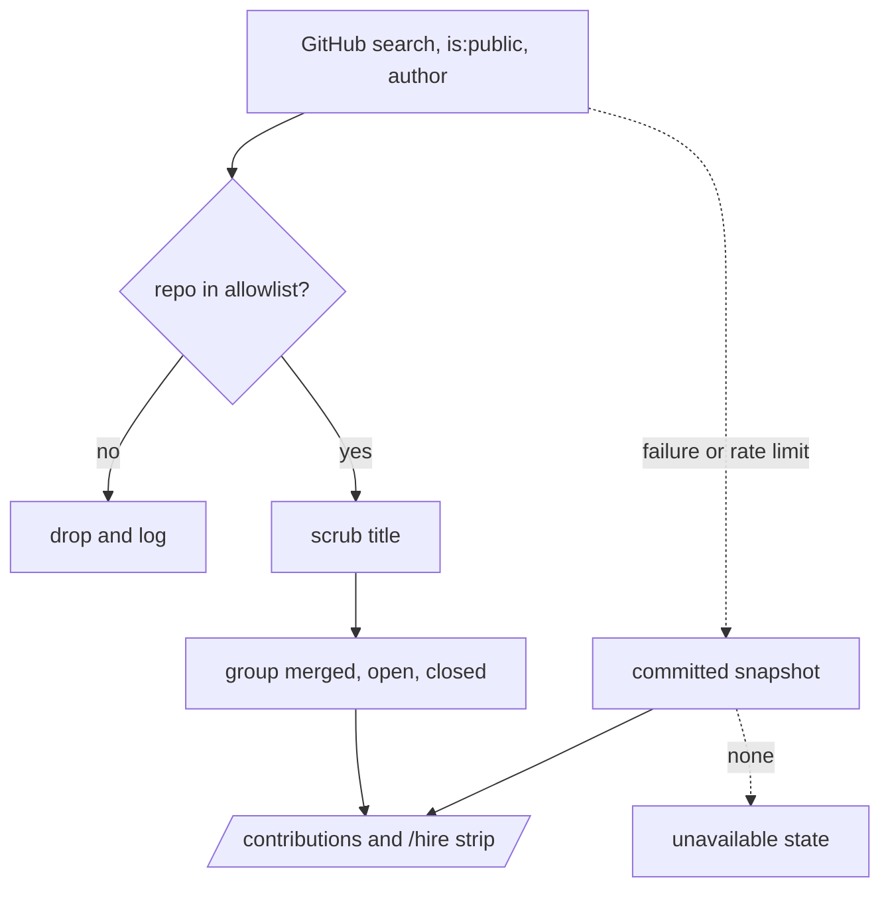

# Recruiter-Ready Portfolio - Plan

## Goal Capsule

- **Objective:** A recruiter who opens luke-the-duke.com sees Luke's strongest current work first, can watch a launch film for every lead project (private ones included), sees what he has contributed to other people's projects, and reaches a current résumé and contact path in two clicks, without any private or work detail leaking.
- **Means:** Polish the existing star-chart design rather than replace it (Key Decision 2), restructure the catalog from the 2026-10-20 tier audit (KTD2, KTD3), add a film-and-showcase dossier mode (KTD4), and add a server-rendered upstream-contributions section (KTD6).
- **Authority:** Luke's request in session; this plan's Requirements; `BRAND.md` for visual rules; `docs/PROJECT-CATALOG-SOP.md` once amended by U3.
- **Execution profile:** All units land on branch `feat/recruiter-overhaul`. Nothing merges to `main` until Luke reviews; one draft PR from the branch to `main` carries the whole overhaul. Films (U10) are produced in the separate `launch-kit` repo.
- **Stop conditions:** Stop and ask if a private repo name, work-org name, or private PR title would render on any public surface and no filter in this plan catches it; if PR #71's CSP blocks a requirement and the fix would loosen the policy beyond the media host; or if a film needs real customer or personal data.
- **Who ships:** Claude implements and opens the draft PR; Luke reviews and merges, uploads new films to R2, and re-exports the résumé PDF.

---

## Product Contract

### Summary

Overhaul portfolio-hub for the job search: tighten spacing and components site-wide, put the ten Tier-1 projects up front with a new featured five, fold mirror repos into their parents and archive the rest into an "earlier work" list, show a launch film plus a hand-written card on every Tier-1 dossier including private ones, add an upstream-contributions section showing merged and pending PRs, and make `/hire` a real recruiter landing.

### Problem Frame

The site's design is liked, but the catalog no longer reflects the work. One of the five featured planets (`stratum-hq`) points at a private work-org repo with no commits in 90 days, while orchestral and Argus, two of the most active public repos, sit in the second ring. About 30 of 73 entries are archived, duplicate, or subtree mirrors, which dilutes every click. Seven launch films exist in R2 but only four are wired (PR #71), and the dossier hides films on private entries, so Kate and Pace show nothing. Luke's upstream PRs (5 merged, 27 open) appear nowhere. `/hire` has a mail link and little proof, and the résumé PDF is hand-edited and stale.

### Requirements

**Catalog and tiers**

- R1. The homepage primary orbit shows orchestral, Argus, kurultai, Pace-Server, and Khan; `stratum-hq` is removed from the catalog.
- R2. The catalog adds cairn, RTS-Skyrim, portfolio-hub, jev-compact, pinetree-solari-demo, and scooter-ios as entries.
- R3. Mirror and companion repos appear only as components of a parent entry: the ten `omarchy-*` widget repos under omarchy-plugins, the seven `a0-plugin-*` repos under one Agent Zero plugins entry, kate-ios under kate, omarchy-wisp under wisp, kurultai_people under kurultai, a0-openrouter-spend under openrouter_usage.
- R4. Duplicate entries collapse to one: `openrouter`/`openrouter-demos` and `military-hardware-db`/`open-military-hardware-db`.
- R5. Archived repos still in the catalog move to an "earlier work" list on `/projects`; entries whose repo no longer exists (`nem-stock-pitch`, `dayflow-screenshots`) and scaffold or README-less entries (`omarchy-neo`, `bartlett-data-platform`, `pace-grafana-dashboards`, `luke-the-duke-show`, `openclaw-macmini-hardened`) leave the catalog.
- R6. Every slug that existed on `main` before this work still resolves: merged slugs redirect to their parent, removed and earlier-work slugs to their new home, in one hop.

**Films and private showcase**

- R7. Every Tier-1 dossier with a film shows it, including private entries (Kate, Pace-Server, Khan).
- R8. A private Tier-1 dossier shows a hand-written showcase card in place of activity, README, and the restricted-survey block, and never shows a repo link, PR titles, or commit data.
- R9. A dossier whose film does not exist yet omits the film slot; it never shows "coming soon".
- R10. Launch films exist for wisp, Tallyline, Khan, cairn, and open-computer, produced to the launch-kit recipe.

**Upstream contributions**

- R11. A contributions section lists Luke's PRs to repositories he does not own, grouped as merged, open, and closed without merge, each linking to the PR.
- R12. The section never shows a private repository, a work-org repository, or an unscrubbed title.
- R13. When GitHub data cannot be fetched, the section shows the last good snapshot or an explicit "unavailable" state, never zero counts.
- R14. Non-PR contributions (the omarchy#8418 issue comment, the Asahi typec patch once sent) appear as hand-curated items marked by type.

**Recruiter path and polish**

- R15. `/hire` shows featured work with films, the contributions summary, role targets, location at city level, the résumé PDF, and the contact path, using only facts already in `src/data/resume.ts` or confirmed by Luke.
- R16. The résumé PDF matches the restructured site and carries a printed revision date.
- R17. Every page gets a spacing, hierarchy, and component-consistency pass within `BRAND.md` rules, with no regression at 390px or under reduced motion.
- R18. At most two new decorative effects ship, both off the homepage, both absent under reduced motion and Save-Data.

### Key Decisions

- **Films show on private projects, behind a hand-written card, not hidden.** Recruiters see the product without the code. Governs R7, R8. (session-settled: user-directed — chosen over keeping private entries film-less: Luke said "yes to films and show them for sure, they still get a card but hand made by us")
- **Polish the current design; do not redesign.** Governs R17, R18. (session-settled: user-directed — chosen over a visual redesign: Luke said "i like where it is, but polish")
- **The featured five come from activity, not legacy.** Governs R1. Recommended in the tier audit; Luke confirmed the scope that named them.
- **Merged mirrors become components, not dossiers.** One level only; a component never gets its own page. Governs R3, R6.

### Success Criteria

- A first-time visitor at 1440px and at 390px reaches a playing film in two clicks from `/` and the résumé PDF in two clicks from any dossier.
- Lighthouse performance on `/` and on a film dossier is no worse than on `main` before this work, measured on the same machine.
- The private-sentinel tests (U8) pass: no private repo identifier (owner/repo slug or repo URL), work-org name, or private PR title appears in any built HTML, sitemap, `llms.txt`, OG metadata, or JSON route. Display names of private catalog entries may render.

### Scope Boundaries

- Applying for jobs, cover letters, and LinkedIn are outside this plan.
- The homepage 3D scene is not rebuilt; only its labels, featured set, and spacing change.
- No new hosting, analytics, or CMS.
- Considered and not built: a client-side live refresh of contributions (CSP from PR #71 forbids client fetches to GitHub, and hourly ISR is fresh enough for recruiters; would change if Luke wants real-time status). A résumé PDF generator or automated PDF checker (U7 adds a revision date and Luke confirms the export; would change if the PDF drifts again after this work). A committed last-good contributions snapshot (the explicit unavailable state satisfies R13 and cannot go stale silently; would change if GitHub outages become frequent). VTT caption files for films (films are silent-first with burned-in text; a one-line transcript sits beside each film; would change if a film adds narration).

#### Deferred to Follow-Up Work

- 9:16 vertical cuts of the films and posting them to X (Luke posts; agents never do).
- Moving the hand-edited résumé PDF to a generated one.

---

## Planning Contract

### Key Technical Decisions

- KTD1. **PR #71 lands on the integration branch first.** It wires four films, adds the media host constants, and adds the strict CSP and SRI that every later unit must live under. Rebasing the restructure onto it later would conflict in both catalog files and the count test.
- KTD2. **Extend `ProjectConfig`, do not add a parallel tier field.** New optional fields: `parentSlug` (marks a component), `era: "earlier"` (marks earlier work), `film` (`url`, `poster`, `transcript`), and `showcase` (hand-written card copy for private entries). `orbitTier` keeps placement; the Oct-12 plan's proposed `tier` field is not introduced. Every consumer that iterates `projectConfigs` (orbit, grid, sitemap, PR aggregation, activity targets, quadrant map, static params) reads through two helpers, `listedProjects()` and `componentsOf(slug)`, so filtering lives in one place. A component never links to a page of its own: on the parent dossier it links to its public GitHub repo (private components show no link), and a homepage moon for a component links to the parent dossier's `#components` anchor.
- KTD3. **Redirects derive from the catalog.** A typed list of retired slugs (`from`, `to`, `reason`) in `src/data/redirects.ts` feeds `redirects()` in `next.config.ts` (308). Components redirect to their parent and removed entries to `/projects`. Earlier-work entries keep no dossier (`dynamicParams = false` stays) and redirect to `/projects#earlier-work`.
- KTD4. **One dossier film-and-showcase mode, decided by data.** The `!project.private` gate on the film is removed; film presence is decided by `film` alone. `showcase` presence switches the private branch to the showcase card and skips `DossierActivityTimeline`, `fetchShowcaseMd`, README, and the restricted-survey plate. Showcase copy lives in the repo, never fetched at runtime. Governs R7, R8. (session-settled: user-directed — chosen over keeping private entries film-less: Luke said "yes to films and show them for sure")
- KTD5. **Films use the existing media host only.** Posters and any transcripts sit on `media.luke-the-duke.com` beside the mp4s, so the PR #71 CSP needs no new host. The film element uses `preload="none"`, a poster, and `playsInline`, and no `crossOrigin` attribute: the media host sends no CORS headers (checked live 2026-10-20), so a CORS-mode request would fail. Mp4s are verified for faststart and HTTP 206 range responses.
- KTD6. **Contributions are fetched server-side with three fail-closed layers.** These are the `is:public` search qualifier, a committed repo allowlist (`src/data/upstream-allowlist.ts`, repo-level), and `scrubActivityText` on titles. Titles are scrubbed with `isPrivate=true` (the strict pattern set; with `false` the scrubber only trims) and fall back to `PR #n` when redacted. Anything outside the allowlist is dropped and logged, not shown. The fetch rides ISR like `ghGet` in `src/lib/github-activity.ts` (revalidate 3600, timeout, null on failure); on failure the section renders the explicit unavailable state. Tests use a fixtures path. Governs R11–R13.
- KTD7. **Contributions live on `/contributions`, with a summary strip on `/hire`, never on `/`.** This keeps the homepage canvas count and weight unchanged, and the page joins the Registry family in `BRAND.md`.
- KTD8. **ThreeUI uses the existing four-site recipe, not SceneFrame.** This is `next/dynamic` with `ssr:false`, the `useMediaQuery` reduced-motion gate, `DecorativeEffectBoundary`, and `aria-hidden`, plus a Save-Data gate (`navigator.connection.saveData`) added for the new placements, as R18 requires. New placements are limited to `/hire` (a WarpFieldBackground or ConstellationField header, chosen during U6 for its 2D-canvas weight) and optionally the `/contributions` header. Pin `@designcodeio/threeui` at exactly 1.2.0. No iframe-based ThreeUI components.
- KTD9. **Tests assert invariants, not counts.** `project-completeness.test.ts` stops hard-coding 73 and 74 and instead asserts the primary orbit equals `HOMEPAGE_FEATURED_SLUGS`, that no component or earlier-work entry is listed, and that every `parentSlug` resolves. The `>30` belt assertion becomes a minimum that the restructured catalog meets.

### High-Level Technical Design

Dossier rendering after U4, by data:

Contributions data flow:

### Sequencing

U1 lands first. U2 (data model) precedes U3 (data) and U4 (dossier). U5 (contributions) is independent after U1. U6 (polish) runs after U3, U4, and U5 so it styles the final structure. U7 (`/hire` and PDF) needs U3, U4, and U5. U8 (privacy and redirect guards) can be drafted after U2; its redirect, showcase, and contributions assertions run once U3, U4, and U5 land, and it must pass before U9. U9 (baselines) is last on this branch. U10 (films) runs in `launch-kit` in parallel; its outputs are wired by a data-only follow-up on this branch.

### Assumptions

- `/hire` states role targets and a city-level location only as they already appear in `resume.ts`; no availability date or "open to work" claim is added without Luke.
- Closed-without-merge PRs are shown in a collapsed group under that neutral label.

---

## Implementation Units

### U1. Land PR #71 on the integration branch

- **Goal:** Bring the four wired films, media-host constants, and the CSP onto `feat/recruiter-overhaul`, with its `kate-ios` entry folded into `kate`.
- **Requirements:** R7; KTD1, KTD5.
- **Dependencies:** none.
- **Files:** `src/data/projects.ts`, `src/data/projects-ext.ts`, `next.config.ts`, `src/components/ProjectDemoVideo.tsx`, `src/lib/project-completeness.test.ts`.
- **Approach:**
  1. Merge `origin/feat/launch-videos` into the branch; PR #71 itself stays open and is closed as superseded when the overhaul PR merges.
  2. Move the `kate-ios` copy and film onto the existing `kate` entry; keep the `kate-ios` entry, which U3 marks as a component of `kate`.
  3. Confirm the CSP's `media-src` covers posters too (`img-src` must include the media host) and that SRI builds under standalone output.
- **Patterns to follow:** PR #71's own diff.
- **Test scenarios:**
  - Exactly one listed entry has display name "Kate" once U3 marks `kate-ios` as a component.
  - The CSP header on `/` includes `media.luke-the-duke.com` in `media-src` and `img-src`.
- **Verification:** `npm run lint`, `npm run test`, and `npm run build` pass on the branch.

### U2. Catalog data model, helpers, and redirects

- **Goal:** Add the fields and helpers that let components, earlier work, films, and showcases exist without every consumer re-filtering.
- **Requirements:** R3, R5, R6, R7, R8; KTD2, KTD3, KTD9.
- **Dependencies:** U1.
- **Files:** `src/lib/types.ts`, `src/lib/catalog.ts` (new: `listedProjects`, `componentsOf`, `earlierWork`), `src/data/redirects.ts` (new), `next.config.ts`, `src/app/sitemap.ts`, `src/lib/github-repo-api.ts`, `src/lib/github-activity.ts`, `src/app/projects/[slug]/page.tsx` (`generateStaticParams` only), `src/lib/catalog.test.ts` (new), `src/lib/project-completeness.test.ts`.
- **Approach:**
  1. Add `parentSlug`, `era`, `film`, `showcase` to `ProjectConfig`; keep `demoVideoUrl` readable until U3 migrates entries to `film`, then remove it.
  2. Route every `projectConfigs` iteration listed in KTD2 through the helpers. PR aggregation and activity targets still include component repos (their PRs are real work) but attribute them to the parent. `fetchAllOpenPullsAggregated` skips every entry with `private: true`, so the public `/api/github/pulls` route never returns a private PR title, branch, or URL (it does today).
  3. Build `redirects()` from `redirects.ts`.
- **Patterns to follow:** `getHomepageOrbitProjects` in `src/lib/project-completeness.ts`; the `/podcast` redirect in `next.config.ts`.
- **Test scenarios:**
  - `listedProjects()` excludes any entry with `parentSlug` or `era: "earlier"`.
  - `componentsOf("omarchy-plugins")` returns its components in catalog order.
  - A `parentSlug` naming a missing slug fails a catalog test.
  - A component with `private: true` under a public parent fails a catalog test.
  - Every `from` in `redirects.ts` names a slug absent from `listedProjects()`, and every `to` is a listed slug, `/projects`, or `/projects#earlier-work`.
  - The sitemap lists exactly the listed slugs.
  - `/api/github/pulls` against fixtures that include a private repo returns no row for it.
- **Verification:** Unit tests pass; `npm run build` emits no dossier for components or earlier work.

### U3. Catalog restructure

- **Goal:** Apply the tier audit to the data.
- **Requirements:** R1–R6; Key Decision 3.
- **Dependencies:** U2.
- **Files:** `src/data/projects.ts`, `src/data/projects-ext.ts`, `src/app/projects/page.tsx`, `src/app/projects/[slug]/page.tsx`, `src/data/demos.ts`, `src/lib/github-activity-fixtures.ts`, `src/lib/project-completeness.ts`, `src/lib/planet-visual.ts`, `src/data/deployments.ts`, `src/data/quadrant-positions.ts`, `src/components/Footer.tsx`, `src/data/resume.ts`, `public/llms.txt`, `src/data/redirects.ts`, `docs/PROJECT-CATALOG-SOP.md`, `docs/CATALOG-AUDIT.md`, `src/lib/project-completeness.test.ts`.
- **Approach:**
  1. Set `HOMEPAGE_FEATURED_SLUGS` to orchestral, argus, kurultai, pace-server, khan; flip `featured` flags; remove argus's explicit `orbitTier`; give orchestral and argus an explicit primary `planetVisual`.
  2. Remove `stratum-hq` and its references in Footer, `resume.ts`, `deployments.ts`, `quadrant-positions.ts`, `llms.txt`.
  3. Collapse the two duplicates and redirect the dropped slugs. Keep `military-hardware-db` (it has the live URL). Keep the `openrouter-demos` slug, but it absorbs the full `openrouter` content: film, `liveUrl`, `demoUrl`, `embeddable`, `planetVisual`, highlights, architecture. Re-key the `slug === "openrouter"` checks in `src/app/projects/[slug]/page.tsx`, `src/data/demos.ts`, and `src/lib/github-activity-fixtures.ts`.
  4. Mark components with `parentSlug`, earlier work with `era`, and delete the removed entries; add redirects for each.
  5. Add the earlier-work list to `/projects` under an `#earlier-work` anchor: a compact Registry-family table of name, one-line description, and year, linking to the public GitHub repo only, with no private entry.
  6. Add the six new entries with copy drawn from each repo's README, written by hand; scooter-ios and RTS-Skyrim are private, so they get `showcase` copy and no repo link.
  7. Amend the SOP: featured five, the component and earlier-work rules, and that the hero count is listed projects.
- **Patterns to follow:** existing entries in `projects-ext.ts`; `docs/PROJECT-CATALOG-SOP.md` entry checklist.
- **Test scenarios:**
  - The primary orbit equals the new featured five in order.
  - No listed entry's repo is archived, per a fixture of archived repo names from the audit.
  - Every slug on `main` before this branch is either listed or appears in `redirects.ts` (fixture: the 73 pre-change slugs).
  - The catalog belt still has at least the minimum the visual test asserts.
  - `/projects/openrouter` redirects to `/projects/openrouter-demos`, which shows the film and the live demo.
  - The earlier-work table renders under `#earlier-work` with no private entry.
- **Verification:** The homepage shows the new five; `/projects` lists components only inside their parents.

### U4. Dossier film and showcase mode

- **Goal:** Show films on every Tier-1 dossier and replace private bodies with a hand-written showcase card.
- **Requirements:** R7, R8, R9; KTD4, KTD5.
- **Dependencies:** U2, U3.
- **Files:** `src/app/projects/[slug]/page.tsx`, `src/components/dossier/ProjectFilm.tsx` (new, replaces `ProjectDemoVideo` usage on dossiers), `src/components/dossier/ShowcaseCard.tsx` (new), `src/components/dossier/ComponentsList.tsx` (new), `src/components/planet/PlanetNode.tsx` (internal link branch for component moons), `src/app/globals.css` or `src/app/design-system/primitives.css`, `src/components/dossier/dossier-mode.test.tsx` (new), `tests/visual/portfolio.spec.ts`.
- **Approach:**
  1. Split the 376-line page into the hero, body (public or showcase), film, components, and footer sections, following the flowchart in High-Level Technical Design.
  2. `ShowcaseCard` renders `showcase` fields only: what it is, who it is for, what Luke built, stack, status; no fetched text.
  3. `ProjectFilm` takes `film` and renders the poster, a one-line transcript, and a play control labelled with the project name; native controls appear after first play; a buffering state shows while loading; on an `error` event it falls back to the poster and transcript with no error text. It renders nothing when `film` is absent.
  4. The dossier footer nav gains a persistent résumé link to the PDF, so the PDF is two clicks from any dossier.
  5. Write showcase copy for Kate, Pace-Server, Khan, RTS-Skyrim, scooter-ios; Luke reviews it in the PR.
- **Patterns to follow:** `MediaFrame`, `SurveyPlate`, `EvidencePanel` in `src/components/design/`; `BRAND.md` Dossier family.
- **Test scenarios:**
  - A private entry with `showcase` and `film` renders the card and the film, and no GitHub link, activity section, or README.
  - A private entry without `showcase` keeps today's restricted body (no regression for entries not yet written).
  - A public entry without `film` renders no film element and no "coming soon" text.
  - A parent with components renders the list under `#components`; public components link to their GitHub repo, private ones have no link (KTD2).
  - A component moon on the homepage links to the parent's `#components` anchor in the same tab.
  - The film element has `preload="none"`, a poster, `playsinline`, and no `crossorigin` attribute.
  - A film whose URL fails to load shows the poster and transcript, not a blank player.
  - Every dossier has a link to the résumé PDF.
- **Verification:** `/projects/kate`, `/projects/pace-server`, `/projects/khan` (no film yet), `/projects/kurultai` render correctly at both widths.

### U5. Upstream contributions

- **Goal:** Show merged, open, and closed-without-merge PRs to other people's repos, safely.
- **Requirements:** R11–R14; KTD6, KTD7.
- **Dependencies:** U1.
- **Files:** `src/lib/upstream.ts` (new), `src/lib/upstream.test.ts` (new), `src/lib/upstream-fixtures.ts` (new), `src/data/upstream-allowlist.ts` (new), `src/data/upstream-curated.ts` (new, for R14 items), `src/app/contributions/page.tsx` (new), `src/components/UpstreamContributions.tsx` (new), `src/components/Header.tsx` or nav component, `src/app/sitemap.ts`.
- **Approach:**
  1. Search `author:duketopceo is:pr is:public -user:duketopceo`, then resolve merge state for closed PRs.
  2. Keep only allowlisted repos. The seed allowlist is the public repos in the 2026-10-20 audit: agent0ai/a0-plugins, akitaonrails/ai-usagebar, omacom/omarchy-mac, omacom/omarchy-port-forward-plugin, NousResearch/hermes-agent, rowboatlabs/rowboat, cline/marketplace, solari-sdk/solari-cookbook, ssupt/omarchy-audio-control, EveryInc/compound-engineering-plugin, ParthJain18/groq_flow. Cofounder-Customer-Projects and Herzog-LLC are never allowlisted.
  3. Group, sort merged-first then by date, and render as a Registry-family table with repo, title, state, and date. Below 640px rows stack title-first with repo and date beneath. Empty groups are omitted with their heading. The closed-without-merge group is a native `details` element, collapsed. Open PRs show the first 10 with a native disclosure for the rest.
- **Patterns to follow:** `ghGet`, `ACTIVITY_REVALIDATE_SECONDS`, and `github-activity-fixtures.ts` in `src/lib/`; `scrubActivityText` in `src/lib/activity-scrubber.ts`.
- **Test scenarios:**
  - A fixture PR on a non-allowlisted repo is dropped.
  - A fixture PR on a private repo is dropped even if its owner is allowlisted.
  - A title containing an email, internal host, or work-org name is scrubbed to `PR #n`.
  - A failed fetch renders the "unavailable" state with no counts.
  - `/contributions` has no horizontal overflow at 390px.
  - Closed PRs resolve to merged or closed-without-merge correctly.
  - Curated items render with their type label and no GitHub fetch.
- **Verification:** `/contributions` shows the 5 merged and 27 open PRs from the audit (fixtures in tests; live in a local build with a token).

### U6. Polish pass and effects

- **Goal:** Tighten spacing, hierarchy, and component consistency on every page, and add at most two decorative effects off the homepage.
- **Requirements:** R17, R18; KTD8; Key Decision 2.
- **Dependencies:** U3, U4, U5.
- **Files:** `src/app/design-system/tokens.css`, `src/app/design-system/primitives.css`, `src/app/globals.css`, `src/components/design/*`, `src/app/page.tsx`, `src/app/projects/page.tsx`, `src/app/about/page.tsx`, `src/app/contact/page.tsx`, `src/app/now/page.tsx`, `src/app/demos/page.tsx`, `src/components/hire/HireBackdrop.tsx` (new), `src/components/design/design-primitives.test.tsx`.
- **Approach:**
  1. Audit each page against the spacing scale in `tokens.css`; replace one-off margins with section and component tokens; remove remaining legacy `glass-card` and `detail-feature-card` classes in favour of `ds-*` primitives.
  2. Unify section headings, metadata rails, and action rows across page families.
  3. Add the `/hire` backdrop through KTD8's recipe; decide the component by measuring bundle and GPU cost on this machine.
  4. The homepage keeps exactly two canvases.
- **Patterns to follow:** `BRAND.md` page families; the four existing ThreeUI sites (`DossierArcField`, `WarpFieldLayer`, `loading.tsx`, `SectorTerrain`).
- **Test scenarios:**
  - Under reduced motion, `/hire` renders zero canvases.
  - With Save-Data set, `/hire` renders zero canvases.
  - The homepage still renders exactly two canvases with motion and zero without.
  - No page has horizontal overflow at 390px.
  - `check-design-system.mjs` passes (radius ≤4px, no backdrop-filter).
- **Verification:** Side-by-side screenshots of every route before and after, at 1440px and 390px, attached to the PR.

### U7. Recruiter landing and résumé

- **Goal:** Make `/hire` the page a recruiter acts from, and bring the PDF in line.
- **Requirements:** R15, R16.
- **Dependencies:** U3, U4, U5.
- **Files:** `src/app/hire/page.tsx`, `src/components/hire/FeaturedWork.tsx` (new), `src/data/resume.ts`, `public/resume.pdf`, `src/app/hire/hire.test.tsx` (new).
- **Approach:**
  1. `/hire` in this order: a header with role targets, city, and the primary Résumé and Email actions (visible without scrolling at 390px); the featured-work strip (featured five with film posters linking to dossiers); the contributions summary (merged and open counts linking to `/contributions`); a closing `TransmissionClose`.
  2. Update `resume.ts` for the restructure and add a `resumeRevisionDate` export; Luke re-exports the PDF with that date printed.
- **Patterns to follow:** `TransmissionClose`, `SurveyPlate`; the Transmission family in `BRAND.md`.
- **Test scenarios:**
  - `/hire` renders five featured items, each linking to a listed dossier.
  - The contributions strip shows the "unavailable" state when data is missing.
  - The Résumé and Email actions render before the featured-work strip in DOM order.
- **Verification:** From `/hire`, a film plays in one click and the PDF opens in one click.

### U8. Privacy and redirect guards

- **Goal:** Make leaks and dead links fail the build, not a recruiter's visit.
- **Requirements:** R6, R8, R12; Success Criteria.
- **Dependencies:** U2, U3, U4, U5.
- **Files:** `tests/visual/security.spec.ts`, `tests/visual/redirects.spec.ts` (new), `scripts/check-privacy.mjs`, `scripts/check-privacy-built.mjs` (new), `package.json`, `.github/workflows/ci.yml`, `src/data/private-denylist.ts` (new).
- **Approach:**
  1. Add `src/data/private-denylist.ts`: private repo identifiers (owner/repo slugs and URLs) and work-org names that must never render. Display names of private catalog entries are not on it. `check-privacy.mjs` stays source-only inside `npm run lint`; a new `check:privacy:built` script scans built output (`.next` HTML, sitemap, `llms.txt`, JSON routes) after `npm run build`, in the Verification Contract and in CI's build job.
  2. A redirect spec requests every pre-change slug and asserts at most one 308 hop to a 200.
  3. The security spec asserts private showcase dossiers carry no GitHub URLs and that no page raises a `securitypolicyviolation`.
- **Test scenarios:**
  - A planted denylisted identifier in a rendered page fails `check:privacy:built`.
  - Every pre-change slug resolves in one hop.
  - `/projects/kate` contains no `github.com` URL.
- **Verification:** `npm run lint` and the Playwright security and redirect specs pass.

### U9. Visual baselines

- **Goal:** Re-baseline after all visual changes, with deterministic data.
- **Requirements:** R17.
- **Dependencies:** U3–U8.
- **Files:** `tests/visual/portfolio.spec.ts`, `tests/visual/portfolio.spec.ts-snapshots/*`, `playwright.config.ts`.
- **Approach:** Add `/contributions`, `/projects/kate` (showcase), and `/projects/kurultai` (public with film) to the route matrix; run with fixtures for activity and contributions; mask video elements; regenerate baselines on this machine and note in the PR that they are aarch64 renders. Record Lighthouse performance for `/` and `/projects/kurultai` on `origin/main` before the work and on the branch head after, on the same machine, and put both numbers in the PR.
- **Test expectation:** none -- this unit refreshes snapshots; behavior is tested in U2–U8.
- **Verification:** `npm run test:visual` passes against the new baselines.

### U10. Five launch films

- **Goal:** Produce films for wisp, Tallyline, Khan, cairn, and open-computer.
- **Requirements:** R10.
- **Dependencies:** none on this branch; wiring follows each upload.
- **Target repo:** `launch-kit` (Remotion), one PR per film.
- **Files:** `src/brands/<product>/tokens.ts`, `src/videos/<product>/`, `capture/<product>/` in `launch-kit`; the `film` field on each entry in portfolio-hub.
- **Approach:**
  1. Per product, inventory design tokens and a seeded fixture with no personal or customer data; capture with Playwright or VHS.
  2. Compose to the launch-kit recipe: 60fps, 16:9 and 1:1, real product visible within 3 seconds, hook of eight words or fewer, end card held two seconds or more, no AI imagery, silent-first with burned-in text.
  3. QC: privacy pass on every frame against the denylist; faststart; poster frame.
  4. Luke uploads to R2; a data-only commit on this branch sets `film`.
  5. Order: wisp and Tallyline first (Tier-1, public), then Khan, cairn, open-computer.
- **Test expectation:** none in portfolio-hub -- film presence is covered by U4's tests.
- **Verification:** Each film plays from its dossier with poster and range requests (206).

---

## Verification Contract

| Gate | Command | Applies to |
|---|---|---|
| Lint, design system, privacy | `npm run lint` | every unit |
| Unit tests | `npm run test` | U1–U8 |
| Build (standalone, SRI) | `npm run build` | every unit |
| Visual and security specs | `npm run test:visual` (local, not in CI) | U4, U6, U8, U9 |
| Built-output privacy | `npm run check:privacy:built` (after build) | U8, every unit after U8 |
| Lighthouse comparison | Lighthouse on `/` and `/projects/kurultai`, before and after | U9 |

Tests and merges never run in the same command. CI runs lint, test, and build only; the visual suite runs locally before the PR is marked ready.

---

## Definition of Done

- All units U1–U9 are committed on `feat/recruiter-overhaul`, and one draft PR to `main` describes them, with before-and-after screenshots and the showcase copy flagged for Luke's review.
- Every gate in the Verification Contract passes on the branch head.
- All five U10 films are produced in `launch-kit`; the draft PR may open earlier, but it is marked ready only after Luke has uploaded them and their `film` fields are set.
- Luke has confirmed the re-exported résumé PDF shows `resumeRevisionDate` and contains no identifier from `src/data/private-denylist.ts`.
- No experimental or abandoned code remains in the diff.

---

## Risks and Dependencies

| Risk | Mitigation |
|---|---|
| A private name leaks through a path the denylist misses (OG image, binary) | U8 scans built output; film QC covers frames; PDF check covers the résumé |
| GitHub search returns a private or work repo | KTD6's three layers; allowlist is repo-level and fail-closed |
| aarch64 baselines differ from earlier x64 baselines | Regenerate all on this machine in U9; note it in the PR |
| PR #71's CSP blocks a needed resource silently | U8's `securitypolicyviolation` assertion |
| Showcase copy overclaims | Luke reviews every showcase card in the PR |

## Sources

- Tier audit: `~/Downloads/claude/portfolio/repo-tiers-2026-10-20.md` (local, not in repo).
- `docs/CATALOG-AUDIT.md`, `docs/PROJECT-CATALOG-SOP.md`, `BRAND.md`.
- PR #71 (`feat/launch-videos`).
- ThreeUI 1.2.0 (MIT): iframe components lack offscreen pause and reduced-motion handling, so only direct-canvas components are used (KTD8).
