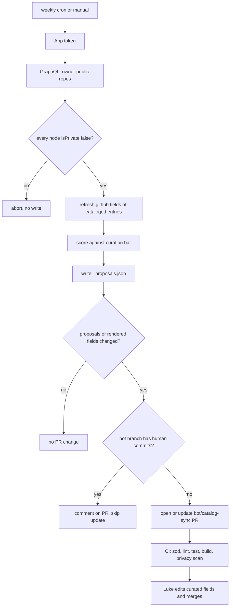
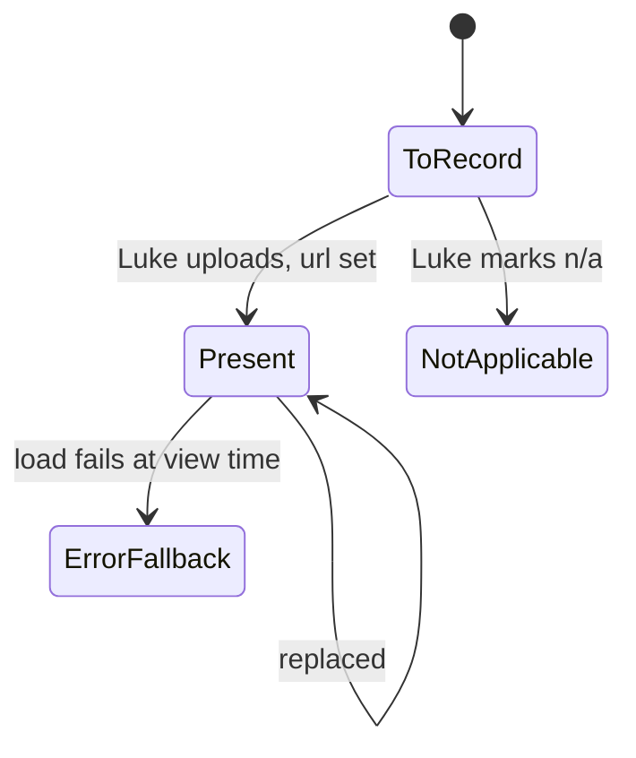

# Portfolio Phase 2: Showcase, Sync and 3D - Plan

**Target repo:** duketopceo/portfolio-hub, branch `feat/portfolio-phase2`, stacked on `feat/recruiter-overhaul` (draft PR #77). Baseline plan: `docs/plans/2026-10-20-0834-feat-recruiter-ready-portfolio-plan.md`.

## Goal Capsule

- **Objective:** Every project on luke-the-duke.com earns its place by a written bar. Every listed project has a release-video slot and a demo-recording slot, each present or marked to record, and private projects carry a hand-written story. The catalog stays current through a weekly proposal Luke approves, and the homepage solar system looks like a survey chart rather than placeholder dots.
- **Means:** Move the catalog to per-project JSON a bot can edit safely (KTD1). Add a two-slot media model (KTD3) and a richer written showcase (KTD4). Add a stateless curation bar (KTD5) and a scheduled sync that only proposes (KTD6, KTD7). Rework planets inside the two existing canvases (KTD8).
- **Authority:** Luke's request and the confirmed scope in session; this plan's Requirements; `BRAND.md`; the baseline plan for anything this plan does not change.
- **Execution profile:** One stacked branch and one draft PR into `feat/recruiter-overhaul` until #77 merges, then retargeted to `main`. Nothing merges without Luke. Videos are produced in `launch-kit` and by the recording recipe here; Luke uploads to R2.
- **Stop conditions:** Stop and ask if any private repo name, owner/repo slug, private PR text, or prose drafted from a private repository's files would appear in a pushed commit, public file, PR body, workflow log or bundle before Luke has approved it. Stop if a demo recording would need real user or customer data. Stop if the homepage could not keep exactly two canvases.
- **Who ships:** Claude implements and opens the draft PR. Luke creates the sync GitHub App, reviews copy and merges. Luke also records or approves recordings and uploads media.

---

## Product Contract

### Summary

The catalog becomes a set of per-project data files, a written curation bar, and a weekly GitHub Action that proposes additions, demotions and metadata refreshes as a single pull request Luke approves. Every listed project gets two media slots, a release video and a demo recording, each either present or marked "to record". Private projects get a richer hand-written showcase, with Pace Server's the deepest. The homepage planets are redrawn as line-art survey plates with instanced moons, a parallax starfield, and a contour shader on one or two focal planets, all inside the two existing canvases.

### Problem Frame

PR #77 fixed what the catalog shows, but every future change is still a hand edit to TypeScript. New repos, archived ones and stale descriptions drift until someone notices. Luke wants the site to stay current without letting small, unused repos back in. Only 7 of 33 listed projects have any video, and there is no place for a longer walkthrough. Private projects, including Pace Server, the strongest work, are limited to a five-field card. The homepage "planets" are CSS dots over a particle sphere, which undersells the star-chart theme the site is built around.

### Requirements

**Curation and size**

- R1. A written curation bar decides whether a repo can be listed: an original (not a fork) and not archived; a README of at least 400 characters; at least 4 commits on the default branch; and either commits in the last 90 days, a live URL, or a release. A repo that is a mirror of a listed parent becomes a component, never a listing.
- R2. The headline catalog targets 30 to 40 listed projects; leaving that range raises a warning in the sync proposal, never an automatic cut.
- R3. No repo joins, leaves or changes tier without Luke approving it.

**Catalog sync**

- R4. A scheduled job detects new public repos and changes to cataloged ones (pushes, releases, description, topics, homepage, archived state, renames), and proposes catalog changes in one pull request.
- R5. The sync never reads, writes, logs or names a private repository. Private entries are authored by hand only.
- R6. The sync never overwrites a human-owned field or a human commit on its proposal branch.
- R7. A cataloged repo that falls below the bar is proposed for demotion with the reasons; the sync keeps no state between runs.

**Media**

- R8. Every listed project has a release-video slot and a demo-recording slot, each in one of three states: present, to record, or not applicable.
- R9. A dossier shows each present video with its own player, poster, captions file when one exists, and an error fallback. The two players fail independently, and slots marked "to record" or "not applicable" render nothing.
- R10. Demo recordings are made only against sanitized demo data or fixtures; a project with no safe demo mode stays "to record".
- R11. A repeatable recording recipe exists for web apps, CLIs and desktop apps, producing web-ready MP4 with a poster and optional captions.

**Showcase**

- R12. Private projects show a hand-written showcase only: no screenshots, metrics or runtime-fetched repository content, besides their videos. Showcase prose is approved by Luke before it is committed.
- R13. Pace Server has the deepest showcase, covering the problem, what Luke built, architecture in prose, outcomes and status.

**Homepage 3D**

- R14. Homepage planets render as line-art survey-plate bodies with orbit hairlines and labels, instanced moons, and a parallax starfield. A contour shader is used on at most two focal planets.
- R15. The homepage keeps exactly two canvases with motion and zero under reduced motion. Under software rendering it falls back to line-art without the shader, and still paints both canvases.
- R16. Lighthouse performance on `/` is no worse than on PR #77's head, measured on the same machine.

### Key Decisions

- **Private projects get a written showcase plus videos only.** Governs R10, R12, R13. (session-settled: user-directed — chosen over a captured-media showcase pipeline: Luke said "private projects just get a written showcase of it")
- **Every listed project gets a release video and a demo recording.** Governs R8, R9, R11. (session-settled: user-directed — chosen over films for lead projects only: Luke said "all can have release videos, as well as demo recordings is the plan")
- **Repos join only by approval.** Governs R3, R4. (session-settled: user-directed — chosen over automatic inclusion: Luke said "not all repos go into it")
- **Polish the current design.** Governs R14. (session-settled: user-directed, carried from the baseline plan — chosen over a redesign)

### Scope Boundaries

- Job applications, LinkedIn and posting videos are outside this plan.
- The dossier, `/contributions` and `/hire` layouts from PR #77 stay as they are, apart from the media section.
- Considered and not built:
  - **Mounting ThreeUI components on the homepage:** every ThreeUI WebGL component opens its own context, which would break the two-canvas rule. Revisit if ThreeUI ships R3F-native components.
  - **TSL node materials:** they do not run under R3F's WebGLRenderer.
  - **The LYGIA shader library:** its licence is not MIT.
  - **AV1 video:** its decode cost on low-end devices outweighs the size win at these lengths.
  - **Auto-merging bot PRs:** every catalog change needs Luke.
  - **Two-run demotion memory:** Luke approves every demotion anyway, so a flapping repo costs one reviewed line; revisit if proposals get noisy.
  - **Chapter tracks:** no requirement needs them; revisit when a demo runs long enough to need navigation.

#### Deferred to Follow-Up Work

- Recording the demos themselves beyond the first two pilots; the recipe and inventory make each later one a data-only change.
- Producing release videos for the listed projects that lack one, as a launch-kit backlog; this plan delivers the slots, the inventory and the recipe, and wires each video as it is uploaded.
- Retiring the failing Docker Swarm `deploy.yml`: production runs on Railway (checked from response headers on 2026-10-20). The cleanup is proposed in the PR description for Luke to approve.

---

## Planning Contract

### Key Technical Decisions

- KTD1. **Per-project JSON with split ownership.** The catalog becomes `src/data/catalog/<slug>.json`, one file per entry, each with a `curated` object (human-owned: copy, tier, parentSlug, era, showcase, media, featured) and a `github` object (bot-owned: node_id, repo name, description, topics, homepage, isFork, isArchived, README length, default-branch commit count, last-commit month, latest release tag). Fast-changing values (stars, exact push time) are not committed; the site keeps fetching those at runtime as today, so a quiet week produces no diff. A zod schema validates them in the sync, in vitest and at `next build`. `src/data/projects.ts` becomes a thin loader exposing the same `projectConfigs`, so the ~25 importers do not change. The loader imports each file statically through a generated index module (`src/data/catalog/index.ts`), not a directory read, so the standalone build and ISR revalidation keep the data; a test checks the index covers every JSON file. The data stays under `src/` because Railway's watch patterns redeploy only on `src/**` and `public/**`.
- KTD2. **The privacy scan reads the JSON.** `scripts/check-privacy-built.mjs` and `scripts/audit-repo-audition.py` stop regex-parsing `projects*.ts` and read `src/data/catalog/*.json`. The script keeps its "fail on zero derived private patterns" assertion, and the sandbox test in `src/data/private-denylist.test.ts` moves with it.
- KTD3. **Two media slots, one component.** `curated.media = { release, demo }`, where each is `{ url, poster?, captions?, transcript }`, `"to-record"`, or `"n/a"`. `film` migrates to `media.release`. `ProjectFilm` becomes `ProjectMedia` with a `kind` prop that sets the label and accessible name. Each player keeps its own error state. On error it shows the poster and transcript, or, with no poster, a short line naming the slot ("Release video unavailable") and a link to the file. Captions are WebVTT served from the site itself (`public/media/captions/`), because the media host sends no CORS headers and a cross-origin track would need `crossorigin` on the video, which breaks playback (checked 2026-10-20).
- KTD4. **Showcase v2 is optional prose sections.** The existing five fields stay. New optional fields: `problem`, `approach`, `architecture` (prose, no diagrams generated from code) and `outcomes`, each plain text with no runtime fetch. `ShowcaseCard` renders whichever sections are present. On a dossier, media comes directly after the summary, then the showcase sections in the order problem, approach, architecture, outcomes.
- KTD5. **The curation bar is a stateless pure function.** `scoreRepo(github, catalog)` in `src/lib/curation.ts` returns `listable | component-candidate | below-bar`, plus the reasons, reading only `github` fields the schema defines. A repo is a `component-candidate` when it mirrors a listed entry (it is named as a component of a listed parent, or matches a configured mirror pattern such as `omarchy-*` widgets); the parent itself stays `listable`. The bar's numbers live in one exported constant and in `docs/CURATION.md`.
- KTD6. **The sync script proposes; it never decides.** `scripts/sync-catalog.mjs` runs one GraphQL query with `ownerAffiliations: OWNER, privacy: PUBLIC` and asserts `isPrivate == false` on every node. It rewrites only `github` fields of existing entries and writes `_proposals.json` for everything else: new candidates above the bar, demotion candidates, archived, renamed or now-forked repos, and range warnings (R2). A cataloged public entry whose node_id is missing from the public set is proposed as stale, by slug only, with no cause stated (it may have gone private). A public repo whose name matches a private entry is reported by catalog slug only, never listed or proposed for listing. New candidates are never written as catalog entries. Luke creates the entry by approving the proposal in the PR, by editing `curated`.
- KTD7. **A GitHub App token and a guarded single PR.** A weekly `.github/workflows/catalog-sync.yml` (cron plus `workflow_dispatch`, `concurrency` set, actions pinned by SHA) mints a token with `actions/create-github-app-token` from a new write-capable "portfolio-sync" App. It opens or updates one PR from branch `bot/catalog-sync` with `peter-evans/create-pull-request`. Before updating, it checks whether the branch has any non-bot commit; if so, it skips the update and comments instead (R6). A GitHub App token makes CI run on the bot PR, unlike `GITHUB_TOKEN`. The PR opens or updates only when `_proposals.json` or a rendered `github` field changes. Workflow `permissions: {}` at the top with job-level minimums, `persist-credentials: false` on checkout, the App token scoped to portfolio-hub, and repo-sourced text (descriptions, topics) passed through files and code-wrapped in the PR body with @mentions neutralized, never interpolated into `run:` steps. If GitHub disables the schedule after 60 days without repo activity, it emails the owner; `docs/CATALOG-SYNC.md` says how to re-enable it.
- KTD8. **3D inside the two existing canvases.** Planets move from CSS dots into `OrbitalScene` as drei `Line` limbs, meridians and orbit hairlines. Moons are one `InstancedMesh`, and the starfield is one `Points` with parallax in `StarfieldScene`. The contour shader (Ashima webgl-noise, MIT, FBM iso-lines) is used only on the featured planets marked `focal`, and only when `shouldUseShader()` holds. That check looks at the WebGL renderer string and returns false for llvmpipe and SwiftShader. Settings: DPR capped at 1.5, no postprocessing; scenes keep animating while visible and pause when off-screen or the tab is hidden (SceneFrame's existing observer), rather than switching to a demand frameloop. Planet and moon links stay in the DOM: `PlanetNode` remains the interactive layer (focus, hover, roving tabindex, labels, links), positioned from the same layout data as the canvas bodies, which are decorative. The CSS plate fallback keeps equivalent labels, links and states.
- KTD9. **The recording recipe lives in the repo as scripts.**
  - **Web apps:** Playwright with `video.size` equal to the viewport, against a fixture seed.
  - **CLIs and TUIs:** VHS tapes.
  - **Desktop:** wf-recorder.
  - **Post-processing:** one ffmpeg script makes H.264 MP4 with faststart and a poster frame, plus optional VTT.

  Media inventory status lives in each entry's `media` field, so the dossier and the inventory never disagree. Every recording passes a sanitization checklist (clean home directory and hostname, fixed prompt, notifications off, fixture accounts only) and Luke reviews a contact sheet of frames plus any caption text before upload; the entry records `sanitized: true`.

### High-Level Technical Design

Sync lifecycle:

Media slot states:

### Sequencing

U1 (data migration) comes first, because everything reads the catalog. U2 (curation function) and U3 (media model) follow in parallel. U4 (showcase v2) depends on U1. U5 (sync script) depends on U1 and U2, and U6 (workflow) on U5. U7 (recording recipe) depends on U3. U8 (3D rework) is independent of U1–U7 apart from reading planet config, so it can run alongside them. U9 (baselines and perf) runs last.

---

## Implementation Units

### U1. Catalog to per-project JSON

- **Goal:** Move all 70 entries to validated JSON with split ownership, without changing any rendered page.
- **Requirements:** R3, R5; KTD1, KTD2.
- **Dependencies:** none.
- **Files:** `src/data/catalog/*.json` (new), `src/data/catalog/schema.ts` (new, zod), `src/data/catalog/index.ts` (new, generated static-import index), `src/data/projects.ts` (loader), `src/data/projects-ext.ts` (removed), `scripts/check-privacy-built.mjs`, `scripts/audit-repo-audition.py`, `src/data/private-denylist.test.ts`, `src/data/catalog/catalog.test.ts` (new).
- **Approach:**
  1. Generate the JSON from the current TypeScript with a one-off script; that script is not committed.
  2. Keep `projectConfigs`' shape and order identical, using an explicit `order` field.
  3. Repoint both scripts and the sandbox test to the JSON.
- **Patterns to follow:** `src/lib/catalog.ts` helpers; `validateCatalog`.
- **Test scenarios:**
  - Every JSON file validates against the schema.
  - `projectConfigs` deep-equals a snapshot of the pre-migration array (captured before editing).
  - An unknown field or a missing `curated.displayName` fails validation.
  - `check:privacy:built` derives the same private patterns as before, and still fails on zero.
  - The index module imports every JSON file in `src/data/catalog/`.
- **Verification:** All PR #77 gates pass unchanged; the visual suite shows no diff; the standalone server (`npm run build` then start) serves a revalidated dossier with catalog data.

### U2. Curation bar

- **Goal:** One pure function decides listability, with reasons and two-run demotion.
- **Requirements:** R1, R2, R7; KTD5.
- **Dependencies:** U1.
- **Files:** `src/lib/curation.ts` (new), `src/lib/curation.test.ts` (new), `docs/CURATION.md` (new), `docs/PROJECT-CATALOG-SOP.md`.
- **Approach:** Encode R1's thresholds in one exported constant. `scoreRepo` takes the `github` object and the catalog, and returns a verdict plus reasons. The SOP points to `CURATION.md` as the source of truth for the bar.
- **Test scenarios:**
  - A fork, or an archived repo, scores `below-bar` with a reason.
  - A repo with a 300-character README scores `below-bar`.
  - A repo with 4 commits, a README of at least 400 characters and a live URL but no recent activity scores `listable`.
  - A mirror of a listed entry (named as its component, or matching a mirror pattern) scores `component-candidate`, while the listed parent stays `listable`.
  - A cataloged repo below the bar scores `below-bar` with every failing reason listed.
- **Verification:** Apply `scoreRepo` to the 2026-10-20 audit data and report the resulting listable count and each current listing's verdict. An out-of-range count is reported to Luke as an R2 warning, never fixed by changing R1's thresholds.

### U3. Two-slot media

- **Goal:** Release video and demo recording on every dossier, each with three states.
- **Requirements:** R8, R9; KTD3.
- **Dependencies:** U1.
- **Files:** `src/data/catalog/schema.ts`, `src/components/dossier/ProjectMedia.tsx` (replaces `ProjectFilm.tsx`), `src/app/projects/[slug]/page.tsx`, `src/components/hire/FeaturedWork.tsx`, `src/app/globals.css`, `public/media/captions/` (new), `src/components/dossier/dossier-mode.test.tsx`.
- **Approach:**
  1. Migrate the 7 `film` entries to `media.release`; every other listed entry gets `"to-record"` for both slots.
  2. Render release first, then demo, each in its own `MediaFrame` with the 16:9 stage from PR #77.
  3. Add a `<track kind="captions">` from `public/media/captions/` only when the file exists; the video keeps no `crossorigin` attribute.
  4. `/hire` keeps using the release poster.
- **Test scenarios:**
  - A dossier with both videos renders two players with distinct accessible names.
  - Release present and demo `"to-record"`: one player and no placeholder text.
  - Both `"n/a"`: no media section.
  - A failing release player falls back to its poster while the demo player still plays.
  - A captions path renders a track element; no captions path renders no track.
  - A failing player with no poster shows the "unavailable" line and a link, not an empty stage.
  - Media renders directly after the dossier summary, release before demo.
- **Verification:** `/projects/kurultai` and `/projects/kate` render correctly at 1440px and 390px; CLS stays 0.

### U4. Showcase v2 and Pace Server

- **Goal:** Richer hand-written showcases, with Pace Server's the deepest.
- **Requirements:** R12, R13; KTD4.
- **Dependencies:** U1.
- **Files:** `src/data/catalog/schema.ts`, `src/components/dossier/ShowcaseCard.tsx`, `src/data/catalog/pace-server.json` and the other private entries' JSON, `src/components/dossier/dossier-mode.test.tsx`.
- **Approach:** Add the optional sections. Draft Pace Server's showcase, and extensions to the other private showcases, in a local file outside the repo (`~/Downloads/claude/portfolio/showcase-drafts.md`) from Luke's notes and the private READMEs (no customer names, internal hosts or unreleased numbers). Nothing drafted from a private repository is committed or pushed until Luke approves that text; the approved copy then goes into the JSON.
- **Test scenarios:**
  - A showcase with only the original five fields renders as today.
  - A showcase with `architecture` renders that section under its heading.
  - No showcase section contains a URL to github.com.
- **Verification:** `/projects/pace-server` reads as a complete story; its committed text matches the version Luke approved.

### U5. Sync script

- **Goal:** Compute bot-owned updates and proposals from public repos only.
- **Requirements:** R4, R5, R6, R7; KTD6.
- **Dependencies:** U1, U2.
- **Files:** `scripts/sync-catalog.mjs` (new), `src/lib/sync.test.ts` (new), `src/data/catalog/_proposals.json` (new), `src/lib/sync-fixtures.ts` (new).
- **Approach:**
  1. Run one paginated GraphQL query (owner, `PUBLIC`).
  2. Abort with no writes if any node is private.
  3. Match entries by repo node_id, falling back to repoName for the first run, and record the node_id.
  4. Update only `github` fields.
  5. Write proposals with reasons.
  6. Exit non-zero on schema failure.

  The script never touches entries whose `curated.private` is true.
- **Test scenarios:**
  - A fixture with a new public repo above the bar: a proposal is added and no catalog file is created.
  - A fixture containing one private node: the run aborts, writes nothing, and no private name appears in stdout.
  - A renamed repo (same node_id): the entry updates and the rename is listed in proposals.
  - An archived repo: an `era: earlier` proposal.
  - A change to `curated` in a fixture entry survives a sync run byte-for-byte.
  - A run with no upstream changes leaves every catalog file and `_proposals.json` unchanged.
  - A cataloged public entry missing from the public set is proposed as stale by slug, with no cause stated.
  - A public repo whose name matches a private entry is reported by slug only and not proposed for listing.
  - A star-count change alone produces no diff.
- **Verification:** A dry run against live public data on this machine writes a plausible proposals file and leaves private entries untouched.

### U6. Scheduled sync workflow

- **Goal:** A weekly, idempotent proposal PR that runs CI and never clobbers Luke's edits.
- **Requirements:** R3, R4, R6; KTD7.
- **Dependencies:** U5.
- **Files:** `.github/workflows/catalog-sync.yml` (new), `docs/CATALOG-SYNC.md` (new).
- **Approach:**
  1. Trigger on cron (weekly) and `workflow_dispatch`, with `concurrency: catalog-sync`.
  2. Mint the App token, run U5, and check the branch for non-bot commits.
  3. Create or update the PR, or comment instead.
  4. The PR body summarizes proposals and range warnings from `_proposals.json` (public names only), with repo-sourced text code-wrapped and @mentions neutralized.
  5. Actions are pinned by SHA; workflow `permissions: {}` with job-level minimums; `persist-credentials: false`.

  The doc lists Luke's setup:
  - Create the portfolio-sync App with contents and pull-request write, install it on portfolio-hub only.
  - Add `SYNC_APP_ID` and `SYNC_APP_PRIVATE_KEY` as repo secrets.
  - Enable "allow GitHub Actions to create pull requests".
- **Execution note:** Configuration-heavy; prove it with a `workflow_dispatch` run on the branch once Luke has created the App, and with a static check of the YAML (actionlint if available locally).
- **Test expectation:** none in vitest; the behavior lives in U5's tests and the dispatch run.
- **Verification:** A manual dispatch opens a draft PR from `bot/catalog-sync` with CI running. A second dispatch with a hand commit on the branch posts a comment and leaves the branch alone.

### U7. Recording recipe and media inventory

- **Goal:** Make every demo recording repeatable, and record the first two.
- **Requirements:** R10, R11; KTD9.
- **Dependencies:** U3.
- **Files:**
  - `scripts/media/record-web.mjs` (new, Playwright)
  - `scripts/media/tapes/*.tape` (new, VHS, per CLI project)
  - `scripts/media/record-desktop.sh` (new, wf-recorder)
  - `scripts/media/encode.sh` (new, ffmpeg)
  - `docs/MEDIA.md` (new)
  - `~/Downloads/claude/portfolio/media-inventory.md` (local report)
- **Approach:**
  1. Write the recipes.
  2. Generate the inventory of all listed projects with each slot's state and blockers.
  3. Record two pilot demos for public projects with safe fixture modes, choosing from kurultai, dayflow-linux and orchestral by fixture readiness, following the sanitization checklist.
  4. Luke reviews each contact sheet, uploads to R2, and the `media.demo` entries are set with `sanitized: true`.
- **Execution note:** Prove each recipe by producing one file and checking it plays from the media host with a 206 range response.
- **Test expectation:** none -- these are operator scripts; their proof is the produced files and their verification.
- **Verification:** Two demo recordings play on their dossiers. The inventory shows every listed project as present, to record (with its blocker) or not applicable.

### U8. Homepage 3D rework

- **Goal:** Survey-plate planets, instanced moons and a parallax starfield inside the two existing canvases.
- **Requirements:** R14, R15; KTD8; Key Decision "Polish the current design".
- **Dependencies:** none (reads planet config through existing helpers).
- **Files:**
  - `src/components/` OrbitalScene and StarfieldScene modules (find exact paths in SolarSystemNav's imports)
  - `src/lib/planet-visual.ts`
  - `src/lib/render-capability.ts` (new, `shouldUseShader`)
  - `src/lib/render-capability.test.ts` (new)
  - `src/components/planet/PlanetNode.tsx`
  - CSS plate fallback styles in `src/app/globals.css`
- **Approach:**
  1. Draw each body as limb and meridian lines sized from `planetVisual`, with orbit hairlines and labels.
  2. Render moons as one InstancedMesh; give the starfield depth layers with parallax.
  3. Apply the contour shader only to featured planets marked `focal` (at most two) when `shouldUseShader()` is true.
  4. Cap DPR at 1.5 and use demand frameloop when idle.
  5. Rework the orbit spacing so labels never overlap at 1280px (issue #46).
  6. Keep `PlanetNode` as the DOM interaction layer over the decorative canvas bodies.
  7. Implement the body states below in canvas and in the CSS fallback.

  | State | Survey-plate body |
  |---|---|
  | Default | Limb and two meridians, hairline orbit, label |
  | Hover or keyboard focus | Limb weight doubles, label brightens, orbit highlighted |
  | Private | Small lock marker beside the label |
  | Focal (at most two) | Contour shader fill when `shouldUseShader()`, otherwise extra meridians |
- **Test scenarios:**
  - `shouldUseShader` returns false for "llvmpipe" and "SwiftShader" renderer strings, and true for a typical GPU string.
  - The homepage keeps two canvases with motion, both painting.
  - Under reduced motion the homepage has zero canvases, and the CSS fallback shows all five featured labels.
  - The roving-tabindex order across planets and component-moon links is unchanged from PR #77.
- **Verification:** Screenshots at 1440px and 390px show line-art bodies with readable labels; the visual and canvas tests pass on this aarch64 machine (software GL).

### U9. Baselines and performance

- **Goal:** Re-baseline, confirm the perf budget, and record results.
- **Requirements:** R15, R16.
- **Dependencies:** U1–U8.
- **Files:** `tests/visual/*`, `tests/visual/portfolio.spec.ts-snapshots/*`.
- **Approach:**
  1. Regenerate baselines in fixture mode.
  2. Run the Lighthouse comparison against PR #77's head on the same machine (mobile, median of 3).
  3. Record the numbers in the PR.
- **Test expectation:** none -- this unit refreshes snapshots; behavior is tested in U1–U8.
- **Verification:** The visual suite passes twice in a row; `/` performance is no worse than PR #77's head.

---

## Verification Contract

| Gate | Command | Applies to |
|---|---|---|
| Lint, design system, source privacy | `npm run lint` | every unit |
| Unit tests (includes zod catalog validation) | `npm run test` | U1–U5, U8 |
| Build | `npm run build` | every unit |
| Built-output privacy | `npm run check:privacy:built` | every unit |
| Visual, redirect and security specs | `VISUAL_TEST_PORT=3187 npm run test:visual` | U1, U3, U4, U8, U9 |
| Sync dry run | `node scripts/sync-catalog.mjs --dry-run` (public data, no writes) | U5 |
| Workflow | `workflow_dispatch` run on the branch after Luke creates the App | U6 |
| Lighthouse | mobile, median of 3, `/` and `/projects/kurultai`, against PR #77 head | U9 |

Tests and merges never run in the same command.

---

## Definition of Done

- U1–U5 and U7–U9 are committed on `feat/portfolio-phase2`, with one draft PR (based on `feat/recruiter-overhaul` until #77 merges). U6 is committed and its dispatch run is waiting only on Luke's App setup. U7's two pilot demos are produced, encoded and sanitized; their playback on the dossiers waits only on Luke's review and R2 upload.
- Every Verification Contract gate that does not need Luke passes on the branch head.
- Pace Server's showcase and every new showcase section are approved by Luke before they are committed.
- The media inventory lists every listed project's two slots with their state and blocker.
- No abandoned experiment code remains in the diff.

---

## Risks and Dependencies

| Risk | Mitigation |
|---|---|
| The sync leaks a private repo name into a public PR or log | Public-only query, abort on any private node, private entries never touched (KTD6); U5 test with a private fixture node |
| The bot overwrites Luke's edits on the open PR | Non-bot commit check before update (KTD7); U5 byte-for-byte curated test |
| The data migration silently changes the catalog | U1 deep-equal snapshot test before and after |
| The privacy scan breaks with the move to JSON | KTD2 repoints it in the same unit, and keeps the zero-pattern assertion |
| The shader fails or crawls under software GL | `shouldUseShader` gate and line-art default (KTD8); canvas paint test |
| Luke has not created the sync App | U6 is complete except its dispatch proof; the DoD records that |
| Scheduled workflow disabled after 60 days idle | GitHub emails the owner; `docs/CATALOG-SYNC.md` documents re-enabling it |
| A demo recording leaks a hostname, path or token | Sanitization checklist and Luke's contact-sheet review before upload (KTD9) |
| Private-repo prose reaches public git history | Drafts stay outside the repo until Luke approves (U4) |

## Sources

- Research dossiers (local): repo state, ThreeUI and procedural 3D, sync and recording best practice, spec-flow edge cases (2026-10-20).
- `docs/CATALOG-AUDIT.md`, `docs/PROJECT-CATALOG-SOP.md`, `BRAND.md`, `docs/RAILWAY.md`.
- Live host check 2026-10-20: `luke-the-duke.com` responds with `x-railway` headers; the Swarm `deploy.yml` has failed on its last three runs.
