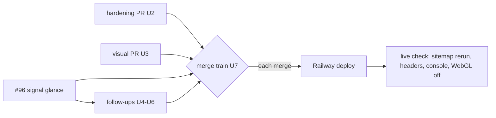

# Cosmic Overhaul, Signal at a Glance and Site Hardening - Plan

**Target repo:** duketopceo/portfolio-hub (luke-the-duke.com, Railway deploys every merge to `main`). Three draft PRs already carry the first pass (U1–U3). This plan owns the gaps they surfaced (U4–U6) and the merge train (U7). Follow-up branch: `feat/cosmic-overhaul-followups`, stacked on `feat/signal-glance` (PR #96).

## Goal Capsule

- **Objective:** A visitor to luke-the-duke.com sees a calm, slowly moving cosmic scene that still looks deliberate without WebGL, and can tell in a few seconds which of Luke's projects are moving. The site exposes nothing it should not and loads fast.
- **Means:** Three parallel PRs for the visual system, the signal section and the hardening pass (U1–U3), then follow-ups that widen the signal to every moving project, clear the console error and make visual baselines reproducible (U4–U6), merged in a fixed order with a live check after each deploy (U7).
- **Authority:** Luke's request and confirmed scope (2026-11-09); this plan's Requirements; `BRAND.md` as updated by U3; `AGENTS.md`.
- **Execution profile:** Draft PRs only. Nothing merges without Luke, because a merge deploys to production.
- **Stop conditions:** Stop if a private repo name, private PR title or private event text would reach the browser, a public file, a PR body or a log. Stop if the home page would need a third WebGL context. Stop if any check needs active probing of the live site.
- **Who ships:** Claude agents implement and open draft PRs. Luke merges, in U7 order.

---

## Product Contract

### Summary

The site gets a black-hole background on every page, three planet types on the home page, stardust lower down long pages, and a two-plus-one palette, each with a designed fallback for no WebGL and reduced motion. The engineering signal becomes a one-glance view of every public project with recent activity. Broken links, exposure risks and slow paths are found and fixed, with a regenerable site map.

### Problem Frame

The site's background is a generic starfield, its color system spreads across several accents, and its engineering section is a feed you have to read rather than a status you can glance at. It tracks only five featured projects, so most of Luke's work never shows as moving. A crawl on 2026-11-09 found 11 broken or local-only outbound links, including `localhost` links on public pages. Nobody has recently checked what the public APIs expose: `/api/activity` returns 538 KB to anonymous callers. Visual tests cannot pass on Luke's machine because baselines drift by a few pixels, and `/` and `/about` log React error #438.

### Requirements

- **R1.** Every page shows a slowly rotating black hole in the background: a dark core with a bright, thin accretion ring, one revolution per about 60–90 s, an original design in the style of the Grok logo's black hole, not the xAI mark.
- **R2.** The home page shows three visually distinct planet types.
- **R3.** Pages long enough to scroll release falling starlight further down the page.
- **R4.** Every piece in R1–R3 has a deliberate static rendition when WebGL is unavailable or fails, and under `prefers-reduced-motion`. Canvas never carries meaning.
- **R5.** The palette is two complementary colors plus one pop color, applied through tokens, with text contrast still passing.
- **R6.** The engineering signal reads at a glance: which projects are moving now, what kind of activity, how recent, how much.
- **R7.** The signal covers every public project with activity in the window, not only the featured five, and counts commits.
- **R8.** A site map of every page, every link off the home page, the redirects and the public data endpoints exists in the repo and can be regenerated.
- **R9.** No public page links to a private, dead or local-only target.
- **R10.** Security and exposure review: no secrets or private data reach the client or public APIs; no unauthenticated route can be used to spend paid API or GitHub quota; security headers are present. Active testing runs only against a local build.
- **R11.** Performance has before-and-after numbers for page weight, per-route JS and the largest public payloads, with the big wins fixed.
- **R12.** No React errors in the console on any route.
- **R13.** Visual regression checks produce the same result on Luke's machine and in CI.

### Key Decisions

- **KD1.** Black hole is an original design in the Grok-logo style, never the mark itself. Governs R1.
- **KD2.** Teal `#2DD4BF` and orange `#FF5C1A` stay as the complementary pair; one pop color is added; other accents fold into these or into neutrals. Governs R5.
- **KD3.** Black hole on every page, planets on the home page only, stardust only on scrollable pages. Governs R1–R3.
- **KD4.** `BRAND.md` and `DESIGN.md` are updated to record the reversal of the earlier "no black hole, no glowing planets" rule, dated 2026-11-09. Governs R1, R2.

### Success Criteria

- A first-time visitor can name the projects that are moving within about three seconds of reaching the signal section.
- With WebGL disabled, the home page still shows the black hole, three planets and stardust as designed static art, not blank space.
- The regenerated site map shows zero broken internal links and no outbound link to a private, dead or local-only target.
- `npm run test:visual` passes on Luke's machine without regenerating baselines locally.

### Scope Boundaries

- No new pages, no new project write-ups, no light mode, no change to Railway hosting.
- No active security testing against the live site.
- Considered and not built: per-visitor live updates of the signal. The page revalidates hourly and day-granular ages are enough for a glance; evidence that visitors expect minute-level freshness would change this.

#### Deferred to Follow-Up Work

- Moving visual baselines into a dedicated container image for every platform beyond CI and Luke's machine.

---

## Planning Contract

### Key Technical Decisions

- **KTD1.** One WebGL context for the background, reused through `SceneFrame`: the black-hole scene replaces `StarfieldScene` rather than stacking on it, and the home page keeps the existing two-canvas ceiling. Stardust uses a 2D canvas or CSS, not WebGL. The background layer is `aria-hidden`, ignores pointer events, sits below content, and is dimmed behind text where the ring would cut legibility.
- **KTD2.** Fallback selection extends `src/lib/render-capability.ts`: a pure decision (WebGL ok, WebGL failed, reduced motion) chooses canvas or the server-rendered SVG rendition per piece.
- **KTD3.** The signal summary is derived on the server (`src/lib/signal-summary.ts`); the browser receives only the summary, never raw activity.
- **KTD4.** Keep the existing per-repo fetches for the featured projects, which supply merges, releases and closes that `contributionsCollection` does not return. Add exactly one account-wide GitHub GraphQL `contributionsCollection` call that supplies commit counts for every repository and finds the other moving catalog projects, so coverage grows by one call per revalidate. Projects found only through that call show commits, opened PRs and opened issues. Commit counts reflect default-branch commits only; branch work surfaces through PR contributions. A repository is private when GitHub's `isPrivate` or the catalog's `private` flag says so (fail closed); private ones stay kind-only, as in #96. The contributions data feeds only the signal summary, never `/api/activity` or any other public route (KTD3).
- **KTD5.** Visual baselines are generated in CI on Linux x64 and committed from there. Matrix screenshots use a fixed-size clip (viewport width by a fixed height) instead of `fullPage`, so every platform produces the same dimensions; the existing `maxDiffPixelRatio: 0.015` covers content noise. Full-page captures hide every animated scene layer (black hole, planets, stardust), extending the existing `.cosmic-bg` injection in `tests/visual/portfolio.spec.ts`, because `animations: "disabled"` does not freeze canvas animation; the static renditions get their own captures under reduced motion and with WebGL disabled.
- **KTD6.** Merge order: #96 (signal) first, then the hardening PR, then the visual PR, then the follow-ups. Each merge is followed by a live check before the next. U4 rides on #96's branch; U5 and U6 are rebased onto `main` after the hardening and visual PRs merge, so U5 knows whether error #438 is already fixed and U6's baselines include the new visuals.

### High-Level Technical Design

### Assumptions

- The GitHub App installation token can read `contributionsCollection` for the public user. If it cannot, U4 keeps the featured-project per-repo data, records the limitation in the PR, and adds no new credential.

### Open Questions (deferred; defaults applied)

- **Visible cap versus "every moving project" (R6, R7).** Default: show up to 8 moving projects and a "+N more moving" link to `/projects`, built from the same server summary. Luke can raise or drop the cap.
- **What counts as a project (R7).** Default: catalog projects only, since the curation bar deliberately keeps small repos off the site. Luke can widen it to any public repo with activity.
- **Which token carries alert and classification meaning once orange joins the complementary pair (KD2, KD4).** Default: the visual PR names one and keeps a distinct alert treatment so alerts still read as alerts.

---

## Implementation Units

### U1. At-a-glance engineering signal (in flight: PR #96)

**Goal:** Replace the activity feed with a server-rendered moving/quiet view.
**Requirements:** R6.
**Dependencies:** none.
**Files:** `src/lib/signal-summary.ts`, `src/lib/signal-summary.test.ts`, `src/lib/github-activity.ts`, `src/app/page.tsx`, `docs/analytics.md`.
**Approach:** Delivered by PR #96 per KTD3. Review only.
**Test scenarios:** covered by the 13 tests in `signal-summary.test.ts` (bucketing, counts by kind, sorting, private filtering, empty history, invalid timestamps, payload size).
**Verification:** PR #96 CI green; screenshot reads at a glance.

### U2. Site map, broken links, security and performance (in flight: agent PR)

**Goal:** R8–R11 in one PR, including `docs/sitemap.md`, its regeneration script, and `docs/audits/2026-11-10-security-perf.md`.
**Requirements:** R8, R9, R10, R11; R12 if the cause of error #438 is small and clear.
**Dependencies:** none.
**Files:** `docs/sitemap.md`, `scripts/` (sitemap generator), `src/data/` (link fixes), `next.config.ts` (headers), API routes under `src/app/api/`, tests beside changed logic.
**Approach:** Owned by the hardening agent. Must not change the signal or canvas components (U1, U3).
**Test scenarios:**
- A project page that linked `http://localhost:8080` renders with no local-only link.
- An injected value in `/api/github/repo/[repoName]/summary` is rejected without calling GitHub.
- An unauthenticated request to the OpenRouter bakeoff route cannot spend quota.
- The built client bundle contains no environment-variable values or token-shaped strings.
**Verification:** findings table with fixes; before/after numbers; `npm run lint`, `test`, `build` pass.

### U3. Black hole, planets, stardust and palette (in flight: agent PR)

**Goal:** R1–R5 with the brand docs updated (KD1–KD4).
**Requirements:** R1, R2, R3, R4, R5.
**Dependencies:** none.
**Files:** `src/components/scene/`, `src/components/planet/`, `src/lib/render-capability.ts`, `src/app/globals.css`, `src/app/design-system/`, `BRAND.md`, `DESIGN.md`, `scripts/check-design-system.mjs`, tests beside changed helpers.
**Approach:** Owned by the visual agent per KTD1, KTD2. Planets restyle three distinct types from the existing procedural set in `src/lib/planet-spec.ts` rather than a new planet system. Static renditions: the black hole is a dark core with the thin ring at the same position and size as the live scene; each planet type has its own SVG; stardust is a sparse fixed dot field on the lower part of long pages.
**Test scenarios:**
- The fallback chooser returns the SVG rendition when WebGL context creation fails.
- The fallback chooser returns static renditions under reduced motion.
- Palette tokens resolve to exactly the two complementary colors plus one pop, and contrast checks pass.
- With WebGL disabled, the home page capture shows the black hole, three planets and stardust (not blank).
**Verification:** screenshots with WebGL on, off, and reduced motion, at phone and desktop widths, with text over the ring legible; per-route JS before/after.

### U4. Widen the signal to every moving public project, with commits

**Goal:** The signal shows all projects with activity in the window and counts commits.
**Requirements:** R6, R7.
**Dependencies:** U1.
**Files:** `src/lib/github-activity.ts`, `src/lib/signal-summary.ts`, `src/lib/signal-summary.test.ts`, `src/lib/github-activity.test.ts`, `src/lib/github-activity-fixtures.ts`.
**Approach:**
1. Add the one account-wide contributions call per KTD4, mapped to catalog projects by repository, alongside the existing featured per-repo fetches.
2. Add a `commit` kind to counts and heat; keep reviews excluded.
3. Repositories with no catalog entry are skipped (Open Questions default); privacy is decided fail-closed per KTD4.
4. Show up to 8 moving rows using U1's row anatomy, and a "+N more moving" link to `/projects` built from the same summary (Open Questions default).
5. Keep the contributions data on the signal-only path; `/api/activity` and its helpers stay unchanged.
**Patterns to follow:** the private filtering, row anatomy and summary shape in `src/lib/signal-summary.ts`.
**Test scenarios:**
- A fixture with commits in six repositories yields six moving rows sorted by event count, then recency.
- A fixture with eleven moving projects shows 8 rows and a "+3 more moving" link.
- A repository missing from the catalog does not appear.
- A repository GitHub reports as private while the catalog marks it public renders kind-only, with its name absent from the output.
- A private repository's commit counts appear without its name in the rendered output.
- Commits contribute to the daily heat bars on the correct UTC day.
- A featured PR opened before the window and merged inside it counts as merged.
- An empty window renders one quiet line, not a blank section.
- When the contributions call fails, the section renders from the featured-project data with no error text shown to visitors.
**Verification:** unit tests pass; home page shows more than the featured five with fixture data; the widened signal adds exactly one GitHub call per revalidate; `/api/activity` responses are unchanged.

### U5. Clear React error #438 on `/` and `/about`

**Goal:** No React errors in the console.
**Requirements:** R12.
**Dependencies:** U2 merged; runs on the follow-ups rebased onto `main` (KTD6), and is skipped if U2 already fixed it.
**Files:** the component that triggers it (found during execution), with a test beside it; `tests/visual/portfolio.spec.ts` console assertion.
**Approach:** Reproduce on a production build, find the cause, smallest fix.
**Execution note:** start with a failing console-error assertion for `/` and `/about`.
**Test scenarios:**
- Loading `/` and `/about` in a production build logs no React error.
**Verification:** the console assertion passes on the branch.

### U6. Reproducible visual baselines

**Goal:** Visual checks give the same answer on Luke's machine and in CI.
**Requirements:** R13.
**Dependencies:** U3 merged; the config and workflow can land earlier, but baselines are regenerated by the CI job from post-U3 `main` (KTD6).
**Files:** `playwright.config.ts`, `tests/visual/portfolio.spec.ts`, `.github/workflows/ci.yml`, `.github/workflows/` (baseline job), `AGENTS.md` (how to update baselines).
**Approach:** Per KTD5:
1. Matrix captures use a fixed-size clip and hide animated scene layers; static renditions get their own captures.
2. A baseline job runs only on `workflow_dispatch` by maintainers, with job-level `permissions: contents: write` and default read elsewhere; it never runs on `pull_request_target` or fork-triggered events.
3. The CI Playwright step also runs `tests/visual/portfolio.spec.ts` on every PR against the committed baselines.
**Test scenarios:**
- A route whose page is a few pixels taller on Asahi produces a capture with the same dimensions as the CI baseline.
- A real layout change (a section removed) still fails.
- A capture taken while the black hole rotates matches its baseline on two consecutive runs.
**Verification:** `npm run test:visual` passes locally on Asahi and in CI against the same committed baselines.

### U7. Merge train and live verification

**Goal:** Ship U1–U6 to production one at a time without regressions.
**Requirements:** all.
**Dependencies:** U1–U6.
**Files:** none (checklist in PR bodies).
**Approach:** Luke merges in KTD6 order. Before #96 merges, retarget the U4 branch to `main`. After the hardening and visual PRs merge, rebase the follow-ups onto `main`, decide U5, and run the CI baseline job. After each Railway deploy, run read-only checks (plain page and header reads, which the live-probing stop condition allows): rerun the site-map script against the live site, check headers, load `/` and `/about` with the console open, load `/` with WebGL disabled and with reduced motion.
**Test expectation:** none -- operational checklist; proof is the live check after each deploy.
**Verification:** live check passes after the final merge.

---

## Verification Contract

| Gate | Command | Applies to |
|---|---|---|
| Lint, design system, source privacy | `npm run lint` | every unit |
| Unit tests | `npm run test` | U1–U6 |
| Build | `npm run build` (with `ACTIVITY_USE_FIXTURES=1` where the sandbox cannot reach GitHub) | every unit |
| Built-output privacy | `npm run check:privacy:built` | U1, U2, U4 |
| Visual, redirect and security specs | `npm run test:visual` | U3, U5, U6 |
| Contrast | `node scripts/check-contrast.mjs` | U3 |
| Live site map | site-map script from U2 against luke-the-duke.com | U7 |

Tests and merges never run in the same command.

## Definition of Done

- U1–U3 PRs are green and reviewed; U4 is committed on `feat/cosmic-overhaul-followups` with a green draft PR; U5 and U6 are committed after that branch is rebased onto `main` past the hardening and visual merges, with baselines from the CI job.
- Every gate above that does not need Luke passes on each branch head.
- No private repo name or private event text appears in any built page, public API response, PR body or log.
- No abandoned experiment code remains in any diff.

## Risks and Dependencies

| Risk | Mitigation |
|---|---|
| The visual PR adds JS weight to every page | Lazy-load after first paint, one WebGL context (KTD1); per-route JS reported before/after |
| Widening the signal leaks private repo names | Fail-closed privacy check and kind-only rendering, with a test that searches the output (KTD4, U4) |
| The contributions query is not allowed for the App token | U4 keeps the featured per-repo data and records it; no new credential (Assumptions) |
| Chromium on Asahi renders differently from CI Linux x64 beyond the clip fix | U6's two-platform scenario proves or disproves parity before the success criterion relies on it |
| Stacked follow-ups strand when #96 merges | Retarget `feat/cosmic-overhaul-followups` to `main` before #96 merges |
| A merge breaks the live site | One merge at a time with a live check (U7); Railway keeps the previous deploy |

## Sources

- Live crawl of luke-the-duke.com, 2026-11-09: 41 pages, 692 outbound links, 11 broken.
- PR #96 report: payload and JS before/after, open questions on commits and coverage.
- `BRAND.md`, `DESIGN.md`, `AGENTS.md`; earlier plans `docs/plans/2026-10-20-2340-feat-portfolio-phase2-showcase-sync-3d-plan.md` (two-canvas ceiling) and `docs/plans/2026-10-26-001-feat-landing-rebuild-plan.md`.
