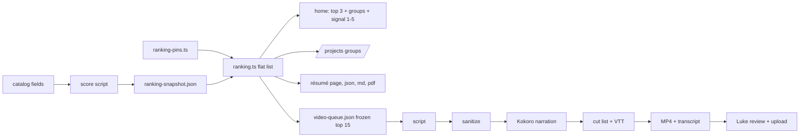

# Portfolio Redesign Round 2 - Plan

**Target repo:** duketopceo/portfolio-hub (luke-the-duke.com; Railway deploys every merge to `main`). Base: `main` at 5c7d804 (overhaul PRs #96–#99 live). Worktree branch: `feat/redesign-r2`. Follows `docs/plans/2026-11-09-2058-feat-cosmic-overhaul-plan.md`, whose open U5 and U6 this plan absorbs.

## Goal Capsule

- **Objective:** A visitor sees Luke's strongest work first on every page, reads it easily over a quiet cosmic background that runs smoothly on an ordinary laptop, and can watch a short narrated video for each of the leading projects.
- **Means:** One ranking (top 3 pinned, then one ranked list) feeding home, `/projects`, the résumé and the video queue (KTD1); a layout redesign around that ranking (KTD3); a receding, adaptive background (KTD4); a contrast test that picks one treatment (KTD5); a local narration and video pipeline (KTD6).
- **Authority:** Luke's request and confirmed scope (2026-11-09, second round); this plan's Requirements; `BRAND.md` as amended here; `AGENTS.md`.
- **Execution profile:** Iterate against a local dev server with screenshots; draft PRs only; Luke merges, because a merge deploys to production. Videos are reviewed by Luke before upload.
- **Stop conditions:** Stop if a private repo name, internal hostname, filesystem path, token or customer data would appear in a video, script, caption, transcript, screenshot or public file. Stop if a voice option needs a paid voice provider without Luke's approval. Stop before anything reaches production other than through Luke's merge.
- **Who ships:** Claude agents implement and produce video drafts; Luke picks the contrast treatment, confirms the top 3, approves each video, uploads media, and merges.

---

## Product Contract

### Summary

Every page is laid out around a single ranking: three pinned lead projects, then everything else in one ranked order, shown in category groups. The résumé follows the same ranking instead of opening with the OpenRouter demo. The background becomes one small, dim black hole over a quiet starfield, tuned for integrated graphics, with a slowly rotating CSS version when WebGL is off. White-on-black and black-on-white are tested side by side on the redesigned pages and one ships. The top 15 projects get narrated explainer or release videos built with a free local voice.

### Problem Frame

The first overhaul shipped and reads as busy rather than strong. The black hole sits behind the lead-systems figure and three planets crowd the hero corners, so the background competes with content. On integrated graphics the home page runs two WebGL contexts, a noise-heavy black-hole shader and high-detail planets with no adaptive quality. The layout grew section by section. The home "lead systems" are a fixed list of five, `/projects` sorts by recency, and the résumé is hand-ordered and opens with the OpenRouter demo panel, so none of them consistently put the best work first. Only 7 of 35 listed projects have any video, and none are narrated.

### Requirements

- **R1.** One ranking orders all listed projects: three pinned lead projects, then one ordered list by a documented score, deterministic between deliberate refreshes.
- **R2.** Home, `/projects` and the résumé (page, `resume.json`, `resume.md`, PDF export) follow that ranking; the résumé does not lead with the OpenRouter demo.
- **R3.** Every page's layout is redesigned around the ranking, home first: content leads, the background stays behind it.
- **R4.** The background is one small, dim, off-center black hole over a quiet starfield; no planets in the background.
- **R5.** The live background holds a frame-rate budget on integrated graphics and steps down quality, then to the static plate, when it cannot.
- **R6.** Without WebGL (and with motion allowed), the black hole still rotates slowly via CSS; reduced motion shows it still.
- **R7.** White text on deep black and black text on white are both built and screenshot locally; Luke picks one; only that one ships, and it passes contrast checks.
- **R8.** The top 15 ranked projects each get a narrated explainer or release video with captions and a transcript, voiced by a free local model by default.
- **R9.** Narration timing is synced to the video's cuts and captions.
- **R10.** The signal never shows one project's numbers on another; a regression test proves distinct projects keep distinct counts.
- **R11.** No React errors in the console on any route; visual checks give the same result on Luke's machine and in CI.

### Key Decisions

- **KD1.** Luke pins the top 3; the score ranks everything else. Governs R1.
- **KD2.** The OpenRouter demo moves from the résumé's lead into its existing dossier (`/projects/openrouter`) and its place in the ranked project list. Governs R2.
- **KD3.** Planets leave the background entirely. Governs R4.
- **KD4.** Paid voice only with Luke's approval; the free local voice is the default. Governs R8.

### Success Criteria

- A first-time visitor names Luke's top 3 projects within about five seconds of landing on home.
- On this M1 Max laptop at 1440×900, the live background (not the static plate) holds at least 55 fps idle and while scrolling, at a recorded quality tier; a throttled or software-GL run shows the step-down and plate switch firing as designed.
- The résumé's first project is the top-ranked project.
- Each of the 15 videos has synced narration, captions and a transcript, and Luke approves it before upload.

### Scope Boundaries

- No new project write-ups, no hosting change, no light/dark toggle for visitors (one treatment ships), no videos beyond the top 15.
- Having a video does not affect ranking, so finished videos never reshuffle pages or the queue.
- `/about` and `/hire` get the shared layout and typography changes only; they carry no project ranking beyond hire's featured work.
- Considered and not built: a GPU benchmark library for tiering (detect-gpu's data stopped updating in Dec 2025 and misreads unknown chips; runtime frame measurement decides instead).

#### Deferred to Follow-Up Work

- Videos for projects ranked 16 and below.
- A cloned or premium voice, if Luke wants one after hearing the local voice.

---

## Planning Contract

### Key Technical Decisions

- **KTD1.** Ranking lives in `src/lib/ranking.ts` and exports one flat ordered list: the 3 pins from `src/data/ranking-pins.ts` first, then every other listed project by extended score descending across all categories, ties by name. Category groups are views over that list, and pinned projects appear only in the top-3 block. The extended score adds live/shipped and recent-activity weights to `scoreProjectCompleteness`; it never reads video presence. Scores are computed by an explicit script from catalog fields into a committed snapshot (`src/data/ranking-snapshot.json`); pages, tests and baselines read the snapshot, never live stars or `Date.now()`. The signal's featured projects become ranking positions 1–5, so home shows one set of leads.
- **KTD2.** The résumé lists projects that have an authored `src/data/resume.ts` entry, in ranking order, keeping their prose; every pinned project gets an authored entry. The OpenRouter `EvidencePanel`, the "OpenRouter-native" eyebrow and the matching metadata leave `src/app/resume/page.tsx`.
- **KTD3.** The home hero drops the `SolarSystemNav` orbit poster (and with it the home page's second WebGL context). Order: hero (name, one-line lede, one primary and one secondary action), top 3 feature cards, engineering signal, ranked category groups, close.
- **KTD4.** Background: black hole only, about a third of the current radius, off-center, low opacity, fewer noise octaves; DPR capped at 1; `preserveDrawingBuffer` off; drei `PerformanceMonitor` lowers quality on sustained drops and switches to the static plate after repeated failure, logging the tier reached. Only swiftshader/llvmpipe/softpipe count as software GL; unknown renderers start live and measurement decides.
- **KTD5.** Contrast variants are a local-only `?theme=ink|paper` switch over a `data-theme` attribute. Layout work proceeds on ink; both token sets are kept until Luke picks from screenshots of the redesigned pages; then the losing set and the switch are removed before merge. `check-contrast.mjs` checks each `[data-theme]` block separately.
- **KTD6.** Narration uses Kokoro-82M (Apache-2.0) locally on CPU; per-paragraph WAV durations drive the cut list and VTT captions. Amazon Polly Neural is the priced paid fallback (word timings via Speech Marks, under $2 for all 15), used only with Luke's approval, with credentials from the local secret store at run time and never written to the repo or logs. A sanitization check (private repo names, internal hostnames, absolute paths, token-shaped strings) runs on each script before any narration and on final captions and transcripts. Recording reuses `scripts/media/` and fixture data only; assembly reuses the video-use helpers.
- **KTD7.** All iteration runs on `ACTIVITY_USE_FIXTURES=1 npm run dev` with Playwright screenshots at 1440 and 390 widths; screenshot sets go to `~/Downloads/claude/portfolio-r2/` for Luke's review before each PR.

### High-Level Technical Design

### Assumptions

- Kokoro runs acceptably on this machine's CPU; if not, the Polly fallback is used only after Luke approves the spend.

---

## Implementation Units

### U1. Ranking model, snapshot and pins

**Goal:** One deterministic ranking for all listed projects.
**Requirements:** R1.
**Dependencies:** none.
**Files:** `src/lib/ranking.ts`, `src/lib/ranking.test.ts`, `src/data/ranking-pins.ts`, `src/data/ranking-snapshot.json`, `scripts/rank-projects.mjs`, `src/lib/project-completeness.ts`.
**Approach:** Per KTD1. Default pins are the top three of the extended score until Luke confirms (Open Questions).
**Test scenarios:**
- Three pinned slugs come first in pin order regardless of score.
- After the pins, projects from different categories interleave by score, ties by name.
- A pinned slug that is unlisted is skipped, the next-ranked project fills the slot, and the build logs the substitution.
- Two runs on the same snapshot give the same order regardless of the current date.
- Category group views list no pinned project.
**Verification:** ranking snapshot of all 35 listed projects reviewed by Luke.

### U2. Résumé follows the ranking

**Goal:** The résumé leads with the top-ranked work.
**Requirements:** R2.
**Dependencies:** U1.
**Files:** `src/app/resume/page.tsx`, `src/data/resume.ts`, `src/components/ResumeDocument.tsx`, `src/app/resume.json/route.ts`, `src/app/resume.md/route.ts`, `scripts/export-resume-pdf.mjs`, tests beside changed logic.
**Approach:** Per KTD2.
**Test scenarios:**
- The first project in `resume.json` equals ranking position 1.
- No OpenRouter panel renders above the résumé body.
- `resume.md` lists projects in ranking order.
- The exported PDF stays within two pages.
**Verification:** résumé page, JSON, Markdown and PDF all open with the same first project.

### U3. Layout redesign

**Goal:** Every page laid out around the ranking, home first.
**Requirements:** R3.
**Dependencies:** U1.
**Files:** `src/app/page.tsx`, `src/app/projects/page.tsx`, `src/app/projects/[slug]/page.tsx`, `src/app/about/page.tsx`, `src/app/hire/page.tsx`, `src/components/` (top-3 card and category-group components), `src/components/FilterBar.tsx`, `src/app/design-system/`, `tests/visual/portfolio.spec.ts`.
**Approach:** Per KTD3.
1. Top-3 cards share one footprint: with a video they show the poster and a play affordance that opens the dossier's video section (no autoplay); without one they show the project's typographic block.
2. `/projects`: top 3, then category groups ranked within. An active filter hides the top-3 band and shows a flat ranked list with a result count; empty categories hide; zero results shows a message with a clear-filter action.
3. Dossier prev/next follows the ranking.
4. Responsive and accessible: cards stack in rank order at 390 width; filter and cards are keyboard operable with visible focus; touch targets are at least 44px; video captions are on by default with a transcript link.
**Test scenarios:**
- Home renders the three pinned projects before the signal section.
- Top-3 cards with and without video render at equal height at 1440 and 390 widths.
- `/projects` renders category groups in rank order with the top 3 above them.
- An active filter hides the top-3 band and shows a result count; zero results shows the clear-filter action.
- Dossier "next" from rank N links to rank N+1.
**Verification:** screenshot set reviewed by Luke at 1440 and 390 widths before the PR.

### U4. Receding, adaptive background

**Goal:** Background stays background and runs on integrated graphics.
**Requirements:** R4, R5, R6.
**Dependencies:** none.
**Files:** `src/components/scene/` (CosmosScene, CosmosLive, BlackHole, SceneFrame), `src/components/cosmos/` (plate), `src/lib/cosmos-mode.ts`, `src/lib/render-capability.ts`, tests beside changed logic, `BRAND.md`.
**Approach:** Per KTD4. The static plate gets a CSS rotation keyframe (60–90 s) unless reduced motion.
**Test scenarios:**
- An Apple or unknown renderer string starts live; swiftshader/llvmpipe start static.
- Sustained low frame rate steps quality down, then switches to the plate, and logs the tier.
- Reduced motion shows the plate with no rotation; WebGL-off with motion allowed shows it rotating.
**Verification:** fps measured with the live scene still running meets the success criterion at a recorded tier; a throttled or software-GL run shows the step-down and plate switch.

### U5. Contrast test

**Goal:** Pick white-on-black or black-on-white with evidence.
**Requirements:** R7.
**Dependencies:** U3 (screenshots taken on the redesigned pages).
**Files:** `src/app/design-system/tokens.css`, `scripts/check-contrast.mjs`, `src/lib/palette.ts`, tests.
**Approach:** Per KTD5; screenshots of both treatments across all routes go to Luke.
**Test scenarios:**
- `check-contrast.mjs` reports each `[data-theme]` block separately, and both pass for body, muted and accent text.
**Verification:** Luke's pick recorded in `BRAND.md`; losing set removed before merge.

### U6. Narrated video pipeline and top 15 videos

**Goal:** Narrated videos for the top 15.
**Requirements:** R8, R9.
**Dependencies:** U1.
**Files:** `scripts/media/narrate.*`, `scripts/media/assemble.*`, `scripts/media/sanitize.*`, `src/data/video-queue.json`, `docs/MEDIA.md`, `src/data/catalog/*.json` (media slots), tests for the cut-list, VTT and sanitization builders.
**Approach:** Per KTD6.
1. Freeze the queue: write the top 15 slugs from the approved U1 snapshot to `src/data/video-queue.json`; production follows that list.
2. Classify each queued project as live recording, terminal recording or slide explainer, and name its fixture source.
3. Script from the catalog entry and README, sanitize, narrate, record against fixtures, assemble.
4. Each finished video goes to Luke for approval and upload; the catalog slot is filled only after upload.
**Test scenarios:**
- Given paragraph WAV durations, the cut list starts each shot at the summed offset.
- Generated VTT cues match paragraph text and timing.
- A script containing a private repo name, an internal hostname, an absolute path or a token-shaped string fails the sanitization check.
**Verification:** 15 approved videos with captions and transcripts; cost table recorded in `docs/MEDIA.md`.

### U7. Signal distinct-counts regression

**Goal:** Prove distinct projects keep distinct counts.
**Requirements:** R10.
**Dependencies:** none.
**Files:** `src/lib/github-contributions.test.ts`, `src/lib/signal-summary.test.ts`.
**Approach:** Research found no mapping fault (live data: Wisp 34 commits/46 PRs, Open Computer 34/48); add a regression test and re-check the live numbers.
**Test scenarios:**
- Two contribution-only projects with different counts render different rows.
**Verification:** test passes; live numbers re-checked against a direct GraphQL read.

### U8. Console errors and reproducible visual checks (carried U5, U6)

**Goal:** No React errors; visual checks agree locally and in CI.
**Requirements:** R11.
**Dependencies:** U3, U4, U5 (baselines change with them).
**Files:** per the previous plan's U5 and U6.
**Approach:** As specified in `docs/plans/2026-11-09-2058-feat-cosmic-overhaul-plan.md` (KTD5, U5, U6 there).
**Test scenarios:**
- Every route in `docs/sitemap.md` logs no React error in a production build (including `/` and `/about`).
- A route a few pixels taller on Asahi produces a capture the same size as the CI baseline.
**Verification:** `npm run test:visual` passes locally and in CI.

---

## Verification Contract

| Gate | Command | Applies to |
|---|---|---|
| Lint, design system, privacy | `npm run lint` | every unit |
| Unit tests | `npm run test` | U1–U8 |
| Build | `ACTIVITY_USE_FIXTURES=1 npm run build` | every unit |
| Built privacy | `npm run check:privacy:built` | U2, U3, U6 |
| Contrast | `node scripts/check-contrast.mjs` | U4, U5 |
| Visual | `npm run test:visual` | U3, U4, U5, U8 |
| Local review | screenshots of `ACTIVITY_USE_FIXTURES=1 npm run dev` to `~/Downloads/claude/portfolio-r2/` | U3, U4, U5 |

## Definition of Done

- U1–U5, U7, U8 in draft PRs with green CI; Luke has seen the local screenshot sets.
- U6: pipeline merged; videos approved and uploaded by Luke, in queue order.
- No private data in any video, script, caption, transcript, screenshot or public file.
- No abandoned experiment code in any diff; the losing contrast token set is removed.

## Risks and Dependencies

| Risk | Mitigation |
|---|---|
| Kokoro too slow or poor on aarch64 CPU | Measure first; Polly fallback only with Luke's approval (KD4) |
| Videos leak private details | Fixture-only recording, sanitization before narration and on final assets, Luke review (KTD6) |
| Adaptive quality misreads Apple GPUs as weak | Only named software renderers start static; runtime measurement decides (KTD4) |
| Ranking surprises Luke | Snapshot review in U1 and pins (KD1) |
| Some top-15 projects cannot be recorded live | Per-project classification in U6 step 2; slide explainers where needed |

## Open Questions

- **Top 3 pins.** Default: the top three by the extended score; Luke confirms.
- **Contrast pick.** Luke chooses after screenshots of the redesigned pages (U5).

## Sources

- Repo research dossier and web research dossier (local, 2026-11-09): ranking code, résumé source, media counts (7 of 35 with video), scene costs, signal live check; TTS pricing (Kokoro Apache-2.0; Polly Neural $16/1M chars; Chatterbox retired Aug 2026; detect-gpu data stale since Dec 2025).
- `docs/plans/2026-11-09-2058-feat-cosmic-overhaul-plan.md`, `docs/MEDIA.md`, `BRAND.md`.
