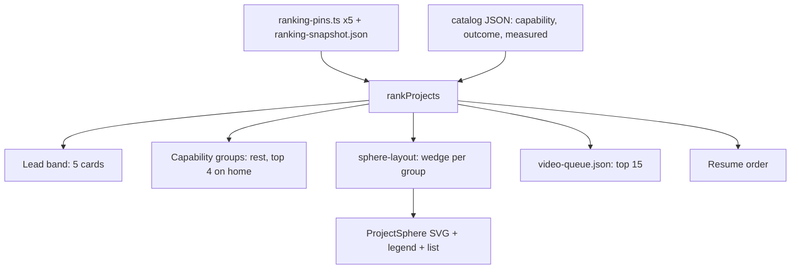

# AI Role Positioning - Plan

## Goal Capsule

- **Objective:** A hiring manager at an AI-native company (Perplexity, OpenRouter, xAI) who opens luke-the-duke.com concludes within seconds that Luke builds model systems, measures them on cost and quality, and ships them.
- **Means:** One pin list and one capability mapping feed the lead band, the grouped lists, the sphere, the résumé and the video queue (KTD1, KTD2); the sphere is drawn in SVG (KTD3); proof numbers come from recorded runs (KTD4).
- **Authority:** Luke's choices in the 2026-11-10 brainstorm; `docs/plans/2026-11-09-2247-feat-portfolio-redesign-r2-plan.md` for everything this plan does not change; `BRAND.md`.
- **Execution profile:** Work on `feat/redesign-r2` and push to draft PR #101. Iterate against `ACTIVITY_USE_FIXTURES=1 npm run dev` on a free port, never 3333. Never merge, deploy or force-push.
- **Stop conditions:** Stop if a measured run would exceed $3 total, bill any OpenRouter key other than the Orchestral eval key, or print a key. Stop if a private repo name, hostname, path or token would reach a public page. Do not edit `src/components/scene`, `src/components/cosmos`, `src/lib/cosmos-mode.ts`, `src/lib/render-capability.ts` or `scripts/media` (PRs #102 and #100).
- **Who ships:** Claude agents implement and push the draft PR; Luke reviews and merges.
- **Open blockers:** none.

---

## Product Contract

### Summary

Five pinned lead projects, chosen for AI-native roles, lead every page in a professional lead band. All projects regroup by capability. The top three carry measured numbers. A Perplexity-style sector sphere maps every project, and the video queue follows the new ranking.

### Problem Frame

The site's leads were picked by a generic completeness score, so the third lead was the portfolio itself, and three lists in the code and older plans disagree on who leads. Projects are grouped by an old category list (finance, ai, osint, infra, apps, data) that says nothing about the work AI-native teams hire for. The catalog carries almost no measured outcomes: no eval scores, pass rates or cost figures. Hiring reviewers reward a few curated projects framed by outcomes and backed by verifiable proof.

### Requirements

**Lead projects**
- **R1.** The pinned leads are, in order: Orchestral, Argus, Kurultai, open-computer, Tallyline. They replace every other lead list.
- **R2.** The lead band shows all five professionally: each card states the outcome first, then the proof (a measured number when one exists, a live link, a video), then the stack.

**Grouping**
- **R3.** Projects group by capability: Evals & routing, Retrieval & memory, Agents & computer use, Products, Tooling & infra. Every listed project belongs to exactly one group.
- **R4.** Within each group, projects keep the existing score order; a lead appears only in the lead band.

**Measured proof**
- **R5.** Orchestral shows pass rate and cost per pass, Argus shows dollars per run and cache-hit rate, and Kurultai shows a retrieval eval score, each from a real, recorded run.
- **R6.** A number that cannot be measured honestly is not shown; no estimated or invented figures.

**Project sphere**
- **R7.** A wireframe sphere divided into one sector per capability group places each listed project as a dot colored by its group, with a legend.
- **R8.** Hovering or focusing a dot shows the project name; activating it opens the project's page.
- **R9.** The sphere heads `/projects`; home shows a compact version under the lead band that links to it.
- **R10.** The sphere rotates slowly unless reduced motion is on, and an accessible list of the same projects carries its meaning.

**Videos**
- **R11.** The frozen top-15 video queue is taken from the new ranking, leads first.

### Key Decisions

- **KD1.** The five leads are Orchestral, Argus, Kurultai, open-computer, Tallyline. (session-settled: user-directed — chosen over a set including OpenRouter demos, which Luke rejected, and over agentflow, jev-compact or fleet-models for the last slots.) Governs R1.
- **KD2.** Capability groups replace the category list for grouping. (session-settled: user-approved — chosen over keeping finance/ai/osint/infra/apps/data.) Governs R3.
- **KD3.** The sphere is drawn without a second WebGL context, to stay inside the integrated-graphics budget. (session-settled: user-approved — chosen over a three.js force graph.) Governs R7.
- **KD4.** Measured numbers come from cheap real runs billed to the Orchestral eval key, and are omitted when they cannot be measured. (session-settled: user-approved — chosen over estimated figures.) Governs R5, R6.

### Success Criteria

- Asked after a few seconds on home, a reviewer names the kind of work Luke does in terms of models, evals or cost.
- Each of the five lead cards shows at least one piece of verifiable proof.

### Scope Boundaries

- No new project write-ups beyond lead-card outcome lines, no hosting change.
- The engineering signal keeps tracking ranking positions 1–5, which now means the five leads.

#### Deferred for later

- Measured numbers for open-computer and Tallyline.
- A full three.js 3D graph.

### Outstanding Questions

#### Deferred to Planning

- How projects are spread within a sector (by score, recency, or similarity) and how the 2D sphere is drawn.
- Which eval set Kurultai's retrieval score uses.

### Sources

- Repo grounding scan (2026-11-10): catalog entries, ranking files, conflicting lead lists, absence of metrics.
- Web research (2026-11-10): reviewers favor 3–5 curated projects, outcome-first case studies, verifiable shipping, evals over API wrappers; react-force-graph is the common 3D option.
- Perplexity memory view (owner screenshot): wireframe sphere with colored dots, legend and hover labels.

---

## Planning Contract

Product Contract preservation: unchanged. Planning adds no requirements and keeps R1-R11 and KD1-KD4 as written.

### Key Technical Decisions

- KTD1. **One pin list, count five.** `src/data/ranking-pins.ts` lists orchestral, argus, kurultai, open-computer, tallyline, and `DEFAULT_PIN_COUNT` in `src/lib/ranking-core.ts` becomes 5 so `leadProjects`, `restProjects` and `categoryGroups` all treat five entries as the lead band. `FEATURED_COUNT` in `src/lib/featured.ts` is already 5 and then equals the leads without change. Governs R1, R2, R4. (session-settled: user-directed, chosen over a set with OpenRouter demos, agentflow, jev-compact or fleet-models: Luke picked these five for AI-native roles.)
- KTD2. **Capability is a new curated field; `category` stays.** Add `capability` to `curatedSchema` as an enum of five ids (`evals-routing`, `retrieval-memory`, `agents-computer-use`, `products`, `tooling-infra`), required for every listed entry (no `parentSlug` and no `era: "earlier"`, the same test `isListed` applies in `src/lib/ranking-core.ts`) by a test and optional in the schema so components and earlier work need no value. `category` stays because planet visuals, OG images, dossier accents and palette tests read it. Group labels, descriptions and colors live in a new `src/data/capability-meta.ts` (client-safe, no catalog import). Governs R3. (session-settled: user-approved, chosen over keeping finance/ai/osint/infra/apps/data: those names say nothing about AI hiring work.)
- KTD3. **The sphere is SVG with a pure layout function.** `src/lib/sphere-layout.ts` maps each listed project to a 3D point; a client component projects those points to 2D and rotates them about the vertical axis. No canvas context and no second WebGL context. Governs R7-R10. (session-settled: user-approved, chosen over a three.js force graph: the integrated-graphics budget.)
- KTD4. **Proof is data on the catalog entry.** Add an optional `outcome` line and a `measured` list to `curatedSchema`. Each measured item holds `label`, `value`, `source`, `measuredOn` and `method`. A missing item is omitted, never estimated. Governs R2, R5, R6. (session-settled: user-approved, chosen over estimated figures: no invented numbers.)
- KTD5. **Sector layout.** Five longitude wedges of 72 degrees, ordered as the groups are listed in R3. Inside a wedge, projects sort by ranking position and follow a golden-angle spiral from the equator outward, so stronger projects sit nearer the front equator. The decision settles the "how projects are spread" deferral; it is deterministic, so server and client agree and tests can pin it.
- KTD6. **Five group colors from three chromatic tokens plus two neutrals.** `BRAND.md` allows teal, ember and ultraviolet only. Groups use teal, ember, ultraviolet, starlight and slate; the legend carries the meaning and a test asserts every color is a `COSMOS_PALETTE` value. Dot color is never the only cue: the legend and the list name the group.
- KTD7. **Kurultai score comes from its labels-only eval.** `kurultai eval` over `evals/golden.json` yields Recall@k and MRR without a judge key. If no daemon is reachable or the run fails, the Kurultai figure is omitted (R6). This settles the "which eval set" deferral.

### Assumptions

- Argus figures come from `evals/results/2026-09-30T06-27-39-967Z.json` in the Argus repo (the committed `src/data/argus-eval.fixture.json` is a copy): dollars per cold run and the warm run's vision calls. The cache-hit item is shown only if the report records cache hits; otherwise it is omitted under R6, and the warm replay's vision-call count is recorded as its own measured item, never as a stand-in for cache-hit rate. KD4's "billed to the Orchestral eval key" governs Orchestral's new runs; Argus and Kurultai figures come from their own real, recorded runs per the run instructions for this plan, and the spend gate sums only runs billed to a key.
- The four résumé entries that already cover the leads (`orchestral`+`argus`, `kurultai`+`jev-compact`, `agentflow`+`open-computer`, `tallyline`+`pace-server`) satisfy "authored entry per lead"; no new résumé prose is needed, and ranking order already yields orchestral/argus, kurultai, open-computer, tallyline.
- Private projects appear on the sphere by display name and slug only, passed through `toClientProject`, exactly as `/projects` cards do today.

### Proposed capability mapping (implementer may move a project, never add or drop a group)

| Group | Projects |
|---|---|
| Evals & routing | orchestral, argus, openrouter, openrouter-usage |
| Retrieval & memory | kurultai, jev-compact |
| Agents & computer use | open-computer, wisp, khan, agentflow, agent-zero-plugins, pinetree-solari-demo |
| Products | tallyline, portfolio-hub, dayflow-linux, pace-server, kate, wordink, dixi, harbor-openrouter-ios-client, cairn, scooter-ios, bartlett-permits, personal-blog, rts-skyrim, pace-gallery, military-hardware-db |
| Tooling & infra | omarchy-plugins, omaseal, helm-qmk-macropad, fivebyfive, homelab, luke-agents, keytypist, snapdex |

### High-Level Technical Design

Directional only.

### Risks & Dependencies

- Visual baselines change on home, `/projects` and dossiers; they must be regenerated by the repo's existing process and may differ between Asahi and CI (round-2 U8 context).
- `scripts/export-resume-pdf.mjs` imports `DEFAULT_PIN_COUNT`; the count change must not break the PDF script.
- Client components must not import the catalog (`src/lib/client-boundary.test.ts`); the sphere receives serializable props.
- Eval spend: Orchestral runs bill real money; the $3 ceiling is a stop condition, not a target.

---

## Implementation Units

### U1. Five pinned leads and the ranking tests

**Goal:** The ranking leads with orchestral, argus, kurultai, open-computer, tallyline.
**Requirements:** R1, R2, R4.
**Dependencies:** none.
**Files:** `src/data/ranking-pins.ts`, `src/lib/ranking-core.ts`, `src/lib/ranking.ts`, `src/lib/ranking.test.ts`, `src/lib/resume-order.test.ts`, `src/lib/featured.ts`, `src/app/page.test.tsx`, `src/app/hire/hire.test.tsx`, `scripts/export-resume-pdf.mjs` (only if it needs the count).
**Approach:** Per KTD1. Update the doc comment on the pins. Tests that assume three leads move to five; keep the substitution test but with a pin count argument.
**Test scenarios:**
- Ranking positions 1-5 equal the five pins in pin order, whatever the snapshot scores.
- `categoryGroups` omits all five leads; `leadProjects` returns five.
- `featuredSlugs()` equals the five pins.
- Résumé entries sort so the first entry covers orchestral, and every pin is covered by an authored entry; résumé.json and résumé.md order match.
- An unlisted pin is replaced by the next-ranked project and reported.
**Verification:** `npm run test` for the touched files.

### U2. Capability model and catalog assignment

**Goal:** Every listed project has exactly one capability group.
**Requirements:** R3, R4.
**Dependencies:** U1.
**Files:** `src/data/catalog/schema.ts`, `src/lib/types.ts`, `src/data/projects.ts`, `src/data/capability-meta.ts`, `src/data/catalog/*.json` (listed entries), `src/lib/ranking-core.ts` (`categoryGroups` keyed by capability), `src/lib/catalog.test.ts`, new `src/data/capability-meta.test.ts`, `BRAND.md` (group colors).
**Approach:** Per KTD2 and KTD6, starting from the proposed mapping. `categoryGroups` groups by `capability`; order groups by best-ranked member as today.
**Test scenarios:**
- Every listed (non-component, non-earlier) catalog entry has a valid `capability`; a missing or unknown value fails the test.
- Group ids in the schema, `capability-meta` and the mapping agree; all five groups have at least one listed project.
- Each group color is a `COSMOS_PALETTE` value.
- Groups keep rank order inside each group (R4).
**Verification:** `npm run test`, `npm run lint`.

### U3. Outcome and measured-proof fields, lead card, lead band

**Goal:** Five lead cards, outcome first, then proof, then stack.
**Requirements:** R2, R5, R6.
**Dependencies:** U1, U2; numbers arrive from U4.
**Files:** `src/data/catalog/schema.ts`, `src/lib/types.ts`, `src/data/catalog/{orchestral,argus,kurultai,open-computer,tallyline}.json`, `src/components/LeadProjectCard.tsx`, `src/app/globals.css` (lead grid and card layout), `src/components/design/MetricRow.tsx` (reuse), `src/app/page.test.tsx`.
**Approach:** Per KTD4. Card order: kicker with capability label, title, `outcome` line, proof row (each measured item as a label and value through `MetricRow` with the method as a short caption, linking to the dossier `#evidence` anchor; else live link, else video), stack chips. Cards stay in rank order with one footprint; no tiering by whether a number exists. Five cards share one footprint and stack at 390 px; layout at 1440 px chosen in the browser (three over two or a five-wide row). Tallyline and open-computer show a live link or video as proof, not a number (deferred per Product Contract). Outcome lines are one factual sentence from the entry's own text.
**Test scenarios:**
- Home renders five `lead-card` articles with ranks 1-5 linking to the pinned dossiers, before the signal section.
- Each card shows at least one proof element (number, live link or video); a lead with no measured items still renders a link or video.
- A card for a project with no `measured` entries renders no number and no placeholder.
- Outcome text appears before proof, and proof before stack, in markup order.
**Verification:** `npm run test`, screenshots at 1440 and 390.

### U4. Measured proof from real runs

**Goal:** Real numbers for Orchestral, Argus and Kurultai, or an explained omission.
**Requirements:** R5, R6.
**Dependencies:** none (data feeds U3).
**Files:** `src/data/catalog/{orchestral,argus,kurultai}.json`, `docs/measurements/2026-11-10-positioning-proof.md` (raw run summary: command shape, models, run ids, cost, date).
**Approach:** Per KTD4 and KTD7.
- Orchestral: run `orch python harness.py ...` (the wrapper bills the dedicated Orchestral key; there is no `orchestral` binary on PATH) for one or two named cheapest-model pairings on a small structural-validated task set with explicit rep counts. `--budget` is not a spend bound in this harness (matrix cells run a floor of replicates), so bound spend by run count, rely on its live-spend abort, and check OpenRouter-reported cost between runs; stop at $2.50. Read pass rate and cost per pass from `python harness.py report --leaderboard` and `--pairings --json`. Already-recorded runs may supply additional context only if their run ids and dates are cited.
- Argus: copy per-model dollars per cold run and the warm replay's vision calls from its own 2026-09-30 report, naming each model id in `method` (no single blended figure); no new spend.
- Kurultai: run `kurultai eval` labels-only against `evals/golden.json`; omit the figure if no daemon is reachable.
- Never print a key; record the OpenRouter-reported cost of each run.
**Test scenarios:**
- Each `measured` item has non-empty `source`, `measuredOn` and `method`, and a date not after today.
- A lead's `measured` value that is blank fails; `source`, `measuredOn` and `method` plus the measurement note's run ids are the enforcement of R6.
**Verification:** The measurement note lists every number, its run ids, and total spend; catalog JSON validates.

### U5. Sphere layout and component

**Goal:** A quiet SVG sphere of every listed project.
**Requirements:** R7, R8, R10.
**Dependencies:** U2.
**Files:** `src/lib/sphere-layout.ts`, `src/lib/sphere-layout.test.ts`, `src/components/sphere/ProjectSphere.tsx`, `src/components/sphere/ProjectSphere.test.tsx`, `src/app/globals.css` (sphere styles).
**Approach:** Per KTD3, KTD5, KTD6. SVG viewBox with thin grey latitude and longitude lines, five wedges shaded by faint boundary meridians, small colored dots (leads slightly larger), a legend of five groups with counts. A requestAnimationFrame loop turns the sphere slowly about the vertical axis; it does not start under `prefers-reduced-motion` and pauses on hover and focus. Dots are links to `/projects/<slug>` with an accessible name; hover and focus show the project name beside the dot. All dots stay focusable and clickable; back-hemisphere dots only dim, and rotation freezes while any dot is hovered or focused. On coarse pointers a first tap on a dot shows its name and a second tap opens the dossier; dots carry transparent hit circles of at least 24 px (44 px on coarse pointers), and the sphere has a set width and legend layout at 390 px. A grouped list of all projects carries the same meaning for keyboard and screen-reader use: visible as a collapsible "All projects by capability" disclosure on `/projects`, visually hidden on home where the capability groups follow. Dot crowding in the large Products wedge is handled by a minimum angular separation in the layout. Props are serializable (slug, name, group, rank); the component never imports the catalog. Style: dark, thin, minimal, matching the ink theme and `BRAND.md`.
**Test scenarios:**
- Layout places every input project exactly once, inside its group's 72-degree wedge, deterministically across calls.
- Higher-ranked projects land nearer the equator than lower-ranked ones in the same group.
- Rotating by any angle keeps every 3D point on the unit sphere.
- Static markup contains one link per project with `href` to its dossier, the legend with five groups, and the full list with every project, on both the home and `/projects` variants.
- Layout keeps a minimum angular separation between any two dots in a wedge.
- Reduced motion: the component renders without starting the animation loop.
**Verification:** `npm run test`; manual check of hover, focus, click and keyboard in the dev server.

### U6. Pages: home, `/projects`, dossier

**Goal:** Place the sphere and capability groups on the pages.
**Requirements:** R2, R3, R4, R9.
**Dependencies:** U2, U3, U5.
**Files:** `src/app/page.tsx`, `src/app/projects/page.tsx`, `src/components/FilterBar.tsx`, `src/components/FilterBar.test.tsx`, `src/components/CategoryGroups.tsx`, `src/components/ProjectCard.tsx`, `src/components/dossier/ProjectHero.tsx`, `src/app/projects/[slug]/page.tsx`, `src/data/category-meta.ts` (kept; dossier accents read category per KTD2), `src/app/page.test.tsx`, `src/lib/catalog-restructure.test.tsx`.
**Approach:**
- Home: hero, five-card lead band, compact sphere (legend collapsed to counts) that links to `/projects`, then the signal strip, then capability groups capped at four with See all.
- `/projects`: sphere heads the page, then capability filter pills, lead band, groups. The filter and the See all links use `?group=<id>`; unknown `?category=` values are ignored.
- Cards and the dossier hero show the capability label; a dossier with `measured` items renders them as an `#evidence` block (label, value, source, date, method) using existing design primitives. This block exists only to make the lead-card numbers verifiable, not as a new write-up.
**Test scenarios:**
- Home markup order: lead band, sphere, signal, groups; the sphere links to `/projects`, and home markup contains every project link in the hidden list.
- Each home group lists at most four projects and no lead; See all links carry the group id.
- `/projects` filter by group shows that group's projects in rank order and the count matches the pill.
- A dossier with measured items shows each with its source; one without shows no evidence block.
- A private project's repo name and GitHub URL never appear in any new markup.
**Verification:** `npm run test`, `ACTIVITY_USE_FIXTURES=1 npm run build`, screenshots.

### U7. Frozen video queue

**Goal:** The top-15 queue follows the new ranking.
**Requirements:** R11.
**Dependencies:** U1, U2.
**Files:** `src/data/video-queue.json`, `src/lib/video-queue.test.ts`.
**Approach:** Per round-2 plan U6 step 1: write the first 15 ranked slugs, leads first, after U1 and U2 settle the ranking; the file records the snapshot `asOf`. Do not touch `scripts/media`.
**Test scenarios:**
- The file holds 15 unique slugs equal to `rankProjects(...)` positions 1-15; the first five are the pins.
- Every queued slug is a listed catalog project.
**Verification:** `npm run test`.

### U8. Visual baselines, screenshots, docs

**Goal:** Visual checks and docs match the new pages.
**Requirements:** all.
**Dependencies:** U3, U5, U6, U7.
**Files:** `tests/visual/portfolio.spec.ts-snapshots/*`, `docs/sitemap.md` if routes or filters changed, `CHANGELOG.md`, `BRAND.md`.
**Approach:** Regenerate only the changed route baselines with the repo's process; capture home, `/projects` and one dossier at 1440 and 390 px to `~/Downloads/claude/portfolio-r2/positioning/`; revert the `AGENTS.md` rewrite by `next dev` before committing.
**Test scenarios:**
- Test expectation: none (screenshots and baselines).
**Verification:** `npm run test:visual` passes locally; screenshots exist.

---

## Verification Contract

| Gate | Command | Applies to |
|---|---|---|
| Lint, design system, privacy | `npm run lint` | every unit |
| Unit tests | `npm run test` | U1-U7 |
| Types and build | `ACTIVITY_USE_FIXTURES=1 npm run build` | every unit |
| Built privacy | `npm run check:privacy:built` | U3, U5, U6 |
| Contrast | `node scripts/check-contrast.mjs` | U3, U5 |
| Visual | `npm run test:visual` | U3, U5, U6, U8 |
| Local review | screenshots from `ACTIVITY_USE_FIXTURES=1 npm run dev` on a free port | U3, U5, U6 |
| Spend | OpenRouter-reported cost of every eval run, summed | U4 |

## Definition of Done

- U1-U8 committed on `feat/redesign-r2` and pushed to draft PR #101; CI decided.
- Five lead cards show proof; every number shown has source, date and method on its catalog entry, and total eval spend is under $3.
- The sphere works by hover, focus, click and keyboard, rotates slowly, and holds still under reduced motion.
- `src/data/video-queue.json` matches the new ranking.
- No file under the forbidden paths changed; `AGENTS.md` is not modified by the diff; no dead-end experimental code remains.
